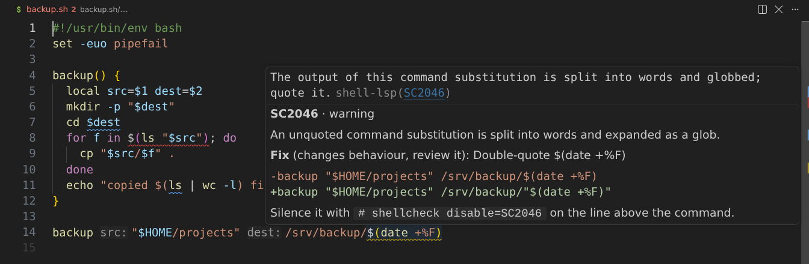
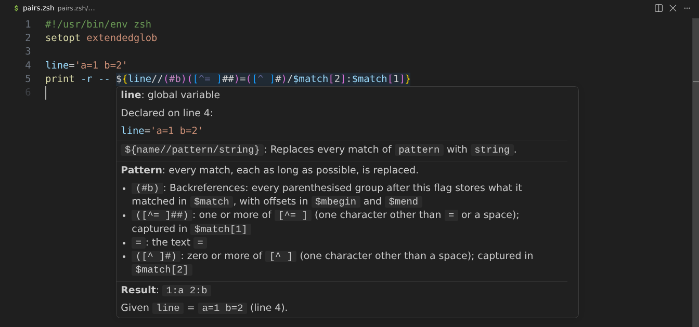
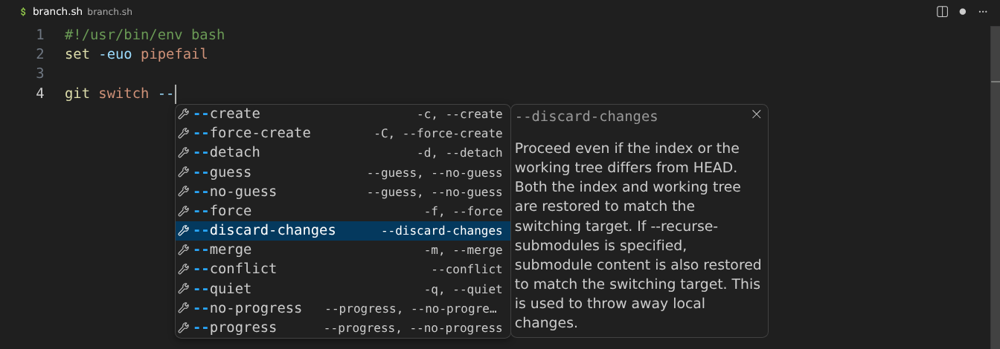

# shell-lsp

[](https://github.com/stubbedev/shell-lsp/actions/workflows/ci.yml)
[](https://github.com/stubbedev/shell-lsp/releases/latest)
[](LICENSE)

shell-lsp is a language server and command-line linter and formatter for shell
scripts (bash, zsh, POSIX sh, dash and ksh) and for the files that embed shell:
justfiles, Makefiles, Dockerfiles and Nix. It began as a shell server and grew
to follow shell into those files, and then to understand each of them as a
language of its own. A `.zsh` file and a `flake.nix` get the same depth.

- **Every shell by its own rules.** Each dialect has its own parser and is
  detected per file. zsh is linted as zsh, which ShellCheck refuses to do.
- **Nix without an evaluator.** Flakes, modules and overlays are followed from
  source, in 95 MiB where nixd uses 576 MiB.
- **The languages are connected.** Shell in a recipe, a `RUN` instruction or a
  Nix string is checked where it stands, and fixes are written back in the
  host's syntax.
- **One binary replaces a toolbox:** shellcheck, shfmt, man, Hadolint, statix,
  deadnix and nixfmt, with their check codes, directives and flags.
- **Compatibility is measured** against ShellCheck on 4,716 scripts and nixfmt on
  all 44,765 files of nixpkgs.



## Quick start

Download the binary and lint a directory (use `linux-arm64` or `darwin-arm64`
for those platforms):

```sh
curl -fsSL -o shell-lsp https://github.com/stubbedev/shell-lsp/releases/download/v0.5.21/shell-lsp-v0.5.21-linux-amd64
chmod +x shell-lsp
./shell-lsp check -f gcc .
```

```text
Dockerfile:1:6: warning: `ubuntu` has no tag, so each build may start from a different image; name a version, as in `ubuntu:<version>` [DL3006]
Dockerfile:2:13: warning: `apt-get install` stops to ask for confirmation, which fails the build; add `-y` [DL3014]
Dockerfile:2:13: note: `apt-get install` also installs recommended packages; add `--no-install-recommends` to install only what is listed [DL3015]
Dockerfile:2:21: warning: pin the version of `curl`, as in `curl=<version>`, so a rebuild installs the same package [DL3008]
Makefile:4:28: note: Unquoted $f is split on whitespace and expanded as a glob; double-quote it. [SC2086]
Makefile:5:2: warning: If cd fails, the following commands run in the wrong directory; add || exit (or || return in a function). [SC2164]
flake.nix:13:53: note: Unquoted $index is split on whitespace and expanded as a glob; double-quote it. [SC2086]
justfile:4:23: error: unknown recipe `test` [SL5002]
justfile:9:16: note: A file matched by *.sh may start with a dash and be read as an option; use ./*.sh or put -- before it. [SC2035]
release.sh:4:81: error: jq: `[` is never closed in the regular expression [SL3003]
release.sh:5:1: warning: If cd fails, the following commands run in the wrong directory; add || exit (or || return in a function). [SC2164]
```

In an editor, put the binary on `PATH` and [point the editor at it](#editor-setup).
In VS Code, `code --install-extension stubbedev.shell-lsp` is enough: the
extension offers to download the binary.

> [!TIP]
> The URL above names the version this README was released with. The
> [latest release](https://github.com/stubbedev/shell-lsp/releases/latest) has
> the current version, the other platforms and `SHA256SUMS`.

## See it work

Real output from v0.5.17 and later, from `shell-lsp check` and from the VS Code
extension.

### In shell scripts

#### zsh, linted as zsh

ShellCheck stops at a zsh shebang. Here the unquoted `$f`, which zsh neither
splits nor globs, is left alone, and what zsh would really get wrong is reported:

```zsh
#!/usr/bin/env zsh
read -r answer
if [[ $answer == (#i)y(es|) ]]; then
  print -r -- "syncing $match[1]"
  for f in *.conf(.N); do
    rsync $f host:
  done
fi
```

```text
sync.zsh:3:18: warning: (#i) is an extended glob operator, and this file never runs `setopt extendedglob`, so zsh matches it literally. [SL2016]
sync.zsh:4:25: warning: $match is only set by a pattern with (#b) or by =~, and nothing in this file uses either. [SL2017]
```

#### Patterns explained

Hover takes the shell's own patterns apart and, when the values are known,
computes the result:



#### Completion from the manual pages

Flags and subcommands of installed commands come from their manual pages, read
without `man`, down to nested subcommands such as `git remote add`:



#### Programs inside a script

awk, sed and jq programs are parsed in place, without running them:

```bash
#!/usr/bin/env bash
wanted=$1
curl -fsSL https://example.com/index.json |
  jq -r --arg name "$wanted" '.[] | select(.name == $name) | .version | test("^v[")'
cd dist
```

```text
release.sh:4:81: error: jq: `[` is never closed in the regular expression [SL3003]
release.sh:5:1: warning: If cd fails, the following commands run in the wrong directory; add || exit (or || return in a function). [SC2164]
```

### In justfiles, Makefiles and Dockerfiles

#### A justfile recipe

The just syntax and the shell in its recipes each know about the other:

```just
version := "1.0"
export out_dir := "build"

package $target: lint test
    mkdir -p "$out_dir"
    cp "$target" "$out_dir/app-{{version}}"

lint:
    shellcheck *.sh
```

`test` is reported as an unknown recipe, with a quick fix that adds it,
`{{version}}` shows its value as an inlay hint, and renaming `$out_dir` from the
shell edits the just variable and every read.

#### A Dockerfile

Hadolint's rules, BuildKit's checks and the shell in `RUN` report together:


#### Fixes written back in the host's syntax

A fix is computed on the shell and escaped for where it lands. In a Makefile
`$f` stays `$$f`, and in a Nix `"` string a quote becomes `\"`:

```diff
-	for f in *.c; do $(CC) -c $$f; done
+	for f in *.c; do $(CC) -c "$$f"; done
```

```diff
-  home.packages = [ (pkgs.writeShellScriptBin "hello" "echo $1") ];
+  home.packages = [ (pkgs.writeShellScriptBin "hello" "echo \"$1\"") ];
```

A fix that cannot be written there is not offered.

### In Nix

#### A script inside a Nix string

A `writeShellScript` string is read as shell with no marker, and findings land
on the line of the `.nix` file:

```nix
{
  inputs.nixpkgs.url = "github:NixOS/nixpkgs/nixos-unstable";

  outputs =
    { nixpkgs, ... }:
    let
      pkgs = nixpkgs.legacyPackages.x86_64-linux;
      channel = "stable";
    in
    {
      packages.x86_64-linux.latest = pkgs.writeShellScript "latest" ''
        index=$(mktemp)
        curl -fsSL https://example.com/index.json > $index
        wanted=${channel}
        ${pkgs.jq}/bin/jq -r --arg name "$wanted" '.[$name]' "$index"
      '';
    };
}
```


#### From a jq variable to the Nix binding behind it

The last line of that script is three languages deep. Definition on `$name`
walks from the jq flag to the shell variable to the Nix binding:


Renames stay honest about where a name lives: renaming `$name` edits the flag
and its reads and leaves `$wanted` alone, and renaming from `${channel}` in the
shell edits the Nix binding.

#### A jump into nixpkgs, with nothing evaluated

Definition on `${pkgs.jq}` opens the package in the nixpkgs that `flake.lock`
pins, read from its source in the Nix store, and `lib.` completes from the same
source:


#### A rename that refuses, and says why

The module system passes `lib` by name, so renaming it in a module would break
the module. The server names what would break instead:


#### Languages written from Nix

A string that Nix writes to a named file is read as that file's language:

```nix
{ pkgs, ... }:
{
  home.file."project/justfile".text = ''
    deploy: build
        rsync -a out/ host:
  '';

  home.file."project/shell.nix".text = ''
    let unused = 1; in pkgs.mkShell { }
  '';
}
```

```text
home.nix:1:3: note: the function never reads its argument `pkgs` [SL8007]
home.nix:4:13: error: unknown recipe `build` [SL5002]
home.nix:9:9: note: `unused` is bound but nothing that is read reads it [SL8005]
home.nix:9:24: error: `pkgs` is not defined here, so Nix rejects the file [SL8002]
```

### On the command line

`check` reports what the editor shows, for every language at once, and takes
ShellCheck's options and output formats:


`fmt` formats shell like shfmt, justfiles like `just --fmt` and Nix like nixfmt,
and leaves the shell in a Nix string as it is, so the string keeps its value.

## What it covers

Every LSP method, in both directions, is listed with its status in
[docs/lsp-methods.md](docs/lsp-methods.md).

| Feature | Shell | Nix | justfile | Makefile | Dockerfile |
| --- | --- | --- | --- | --- | --- |
| Checks | `SC`, `SL` | `SL8`, and `SC` in strings | `SL5`, and `SC` in recipes | `SL6`, and `SC` in recipes | `SL7`, `DL`, and `SC` in `RUN` |
| Quick fixes | yes | yes | yes | yes | for the shell |
| Completion, hover | yes | yes | yes | yes | yes |
| Signature help | yes | yes | yes | yes | for the shell |
| Definition, references, highlight, rename | yes | yes | yes | yes | yes |
| Call hierarchy | yes | yes | yes | yes | no |
| Outline, workspace symbols | yes | yes | yes | yes | yes |
| Semantic tokens, folding, selection ranges | yes | yes | yes | yes | yes |
| Inlay hints | yes | yes | yes | yes | no |
| Document links | `source` paths | paths, URLs, flake inputs | `import`, `mod` | `include`, prerequisites | no |
| Code lenses | references, Bats "Run" | references, `nix build`, `nix run`, `nix flake check` | references, "▶ Run" | references, "▶ Run" | references |
| Formatting | shfmt's printer | nixfmt 1.5.0 | `just --fmt` | spacing only | no |
| Refactorings | [yes](docs/shell.md#refactorings) | [yes](docs/nix.md#everything-else) | no | no | no |
| Compared with | ShellCheck, bash-language-server | nixd, nil, nixfmt, statix, deadnix | just 1.58 | GNU Make 4.4 | BuildKit 0.34, Hadolint 2.14 |

| Inside a shell string | awk | sed | jq |
| --- | --- | --- | --- |
| Syntax errors and regular expressions | [`SL3001`](docs/rules.md#sl3001) | [`SL3002`](docs/rules.md#sl3002) | [`SL3003`](docs/rules.md#sl3003) |
| Semantic tokens | yes | yes | yes |
| Hover | builtins | commands and flags | builtins |
| Completion, signature help | yes | no | yes |
| Variables bound on the command line | `-v`, `--assign` | no | `--arg`, `--argjson`, `--slurpfile`, `--rawfile` |

The linter has 459 `SC` checks, 143 `SL` checks and 54 `DL` checks, each listed
with its severity in [docs/checks.md](docs/checks.md).

## Installation

- **Release binaries** for Linux and Windows (amd64 and arm64) and macOS (arm64)
  are attached to every [GitHub release](https://github.com/stubbedev/shell-lsp/releases)
  with a `SHA256SUMS` file. Check the download with
  `sha256sum --check --ignore-missing SHA256SUMS`, make it executable and put it
  on `PATH` as `shell-lsp` (`shell-lsp.exe` on Windows, see
  [docs/editors.md](docs/editors.md#windows)).
- **Go** 1.27.3 or newer: `go install github.com/stubbedev/shell-lsp@latest`
- **Nix**, built from source with the test suite: `nix profile install github:stubbedev/shell-lsp`,
  or try it with `nix run github:stubbedev/shell-lsp -- --version`
- **VS Code** and VSCodium: the [Shell LSP extension](editors/vscode)
  (`stubbedev.shell-lsp` on the Visual Studio Marketplace and Open VSX, and a
  `.vsix` on every release) runs the server, exposes its settings, and offers to
  download and verify the release binary.

## Editor setup

The server speaks LSP over stdio and needs no arguments. Attach it to the file
types you want. **Neovim** 0.11 and later:

```lua
vim.lsp.config("shell_lsp", {
  cmd = { "shell-lsp" },
  filetypes = { "sh", "bash", "zsh", "ksh", "make", "just", "dockerfile", "nix" },
  root_markers = { ".git" },
})
vim.lsp.enable("shell_lsp")
```

[docs/editors.md](docs/editors.md) covers Helix, Zed, older Neovim, any other
client, and Windows.

> [!NOTE]
> Run it alone on the files it handles. With bash-language-server, nixd, nil or a
> Dockerfile language server on the same files, the editor gets every answer twice.

## Command line

```sh
shell-lsp                                # serve LSP over stdio
shell-lsp check .                        # lint every file it knows below .
shell-lsp check -f sarif . > out.sarif   # for GitHub code scanning
shell-lsp fmt -d .                       # show what formatting would change
shell-lsp fmt -w script.sh               # format in place
```

`check` takes ShellCheck's options, `.shellcheckrc` files, output formats and
exit codes, and `fmt` takes shfmt's flags, so both drop into CI and pre-commit
hooks where `shellcheck` and `shfmt` ran before. Flags, formats and recipes are
in [docs/cli.md](docs/cli.md).

## Configuration

Settings arrive as `initializationOptions`, as the `shellLsp` section of
`workspace/didChangeConfiguration`, or through `workspace/configuration`, per
workspace folder. Unknown keys and invalid values are rejected with an error
naming the field.

```json
{
  "dialect": "bash",
  "lint": {
    "enable": true,
    "exclude": ["SC2034"]
  }
}
```

<details>
<summary>Every setting</summary>

| Key | Default | Meaning |
| --- | --- | --- |
| `dialect` | detected per file | Force `bash`, `zsh`, `sh`, `dash`, `ksh` or `busybox` for every document |
| `lint.enable` | `true` | Report lint findings alongside syntax errors |
| `lint.profile` | `recommended` | How much to report: `recommended`, `minimal` or `strict` |
| `lint.exclude` | `[]` | Codes to suppress, as `SC2034` or `2034` |
| `lint.optional` | `[]` | Opt-in checks to enable by name, such as `require-variable-braces`, or `all` |
| `format.enable` | `true` | Answer formatting requests |
| `format.indent` | editor setting | Spaces per level; `0` indents with tabs |
| `format.binaryNextLine` | `false` | Put `&&`, `\|\|` and `\|` at the start of continuation lines |
| `format.switchCaseIndent` | `false` | Indent `case` arms inside `case ... esac` |
| `format.spaceRedirects` | `false` | Write `> file` instead of `>file` |
| `format.functionNextLine` | `false` | Put the opening brace of a function on its own line |
| `format.simplify` | `false` | Apply shfmt's simplifications (like `shfmt -s`) |
| `format.minify` | `false` | Minify the script (like `shfmt -mn`) |
| `nix.evaluate` | `false` | Evaluate flakes with `nix` to complete and describe NixOS, home-manager and flake-parts options and nixpkgs attributes |

</details>

How the dialect of a script is decided is in [docs/shell.md](docs/shell.md#dialects),
the lint profiles in [docs/linting.md](docs/linting.md#profiles), and how
`.editorconfig` and the `format.*` settings interact in
[docs/formatting.md](docs/formatting.md).

## How it compares

| Tool | What shell-lsp takes over | Evidence | What differs |
| --- | --- | --- | --- |
| [ShellCheck](https://github.com/koalaman/shellcheck) | Check codes, directives, `.shellcheckrc`, options, formats, exit codes | Over 4,716 corpus scripts, [`corpus/shellcheck.md`](corpus/shellcheck.md): 54,290 findings agree, 10,225 only ours, 3,250 only ShellCheck's | Its own messages and `SL` checks, and it lints zsh. [All differences](docs/cli.md#differences-from-shellcheck) |
| [shfmt](https://github.com/mvdan/sh) | Printer, flags, `.editorconfig` keys | Built on a fork of the same library | [Also formats](docs/formatting.md) justfiles, Makefiles and Nix |
| [bash-language-server](https://github.com/bash-lsp/bash-language-server) | Everything it offers, for every dialect | Completion recall 135/137 against 123/137, [`docs/crosscheck.md`](docs/crosscheck.md) | Lints without an external shellcheck |
| [nixd](https://github.com/nix-community/nixd) | Navigation, completion, hover, rename, formatting | Compared question by question with `cmd/nixparity`, [`docs/corpus.md`](docs/corpus.md#nix-server-parity) | Nothing is evaluated by default, see below. Deliberate differences are [listed](docs/corpus.md#differences-that-are-decided) |
| [nil](https://github.com/oxalica/nil) | The same | The same | Reads the whole project, where nil does not; no type inference on hover |
| [statix](https://github.com/molybdenumsoftware/statix), [deadnix](https://github.com/astro/deadnix) | Lints and findings, `statix.toml`, `# deadnix: skip` | On 2,500 nixpkgs files, [`corpus/nix-lint.md`](corpus/nix-lint.md): 676 agree, 65 only ours, 0 only theirs | [Details](docs/rules.md#statix-and-deadnix-compatibility) |
| [nixfmt](https://github.com/NixOS/nixfmt) | Output, byte for byte | 0 differences across 44,765 files | Default width and indent only |
| [Hadolint](https://github.com/hadolint/hadolint) | `DL` codes, pragmas, `.hadolint.yaml` | More than 500 Dockerfiles run through it | [Deliberate differences](docs/hadolint.md) |

### Performance

| Measure | shell-lsp | For comparison |
| --- | ---: | --- |
| `check` over the 1,219 shell scripts of nixpkgs, 12 cores | 0.18 s | one `shellcheck` process: 20.7 s, with a different rule set |
| A keystroke with 700 scripts open, typing in one (v0.5.17) | 20.5 ms | |
| Peak memory on an 89-file flake | 95 MiB | nixd 576 MiB, nil 380 MiB |
| Peak memory on nixpkgs | 145 MiB | nixd 394 MiB; nil does not index a project |

The method, idle figures and how to rerun them with `just nix-parity-large` are
in [docs/corpus.md](docs/corpus.md#latency-memory-and-failures). The test suite
holds keystrokes to allocation budgets and parsing and completion to time budgets.

### Where it falls short

- **fish and csh are not supported.** Scripts whose shebang names them are reported as unsupported.
- **Dockerfiles are not formatted**, and Dockerfile findings have no quick fixes of their own beyond the shell's.
- **Large projects stop being followed**: past 4096 files or 8 MiB of source, and a workspace scan stops at 20000
  files. A rename that has to know every reader is then refused.
- **Prebuilt binaries** cover Linux and Windows on amd64 and arm64 and macOS on arm64.
- **`nix.evaluate` is off by default and needs Nix.** Without it nothing is evaluated, so generated `pkgs`
  attributes get no answer. `pkgs.nerd-fonts.jetbrains-mono`, members of a set `callPackage` builds such as
  `pkgs.writers.writePython3`, and the versions nixd shows as inlay hints all need the setting. nixd answers
  these out of the box, since it evaluates `<nixpkgs>` on its own. Turning it on can fetch the flake's inputs
  over the network, uses CPU for as long as an evaluation runs and keeps results in a disk cache. It requires
  Nix 2.24 or newer, Lix 2.95 or newer, or Determinate Nix based on Nix 2.24 or newer.
- **nixd and nil still answer some questions shell-lsp does not.** Those found so far are recorded by class in
  [docs/corpus.md](docs/corpus.md#differences-that-are-decided), with the cases where the difference is deliberate.
- **`pkgs.x` needs a `flake.lock`** whose nixpkgs is in the store, or a file inside a nixpkgs checkout.
  `nix-shell -p x` leads to `x` only where one of the project's overlays sets it.
- **Shell that Nix assembles across `${...}`**, such as a `case` whose patterns come from `lib.optionalString`,
  cannot be checked, and may be reported as a syntax error.
- **A string passed to a wrapper in another file** is linted only after a background pass has proven it.
- **Some variables stdenv reads**, such as `dontPatchShebangs`, still report `SC2034`.

## Documentation

The documentation is also a [searchable site](https://stubbedev.github.io/shell-lsp/).

| Topic | Page |
| --- | --- |
| Editors, Windows, requests for client authors | [docs/editors.md](docs/editors.md) |
| `check` and `fmt`, CI, pre-commit | [docs/cli.md](docs/cli.md) |
| Dialects, completion and hover, sourced files, embedded programs, refactorings, Bats | [docs/shell.md](docs/shell.md) |
| Profiles, quick fixes, directives, `.shellcheckrc` | [docs/linting.md](docs/linting.md) |
| Every check, and `SL` rules in depth | [docs/checks.md](docs/checks.md), [docs/rules.md](docs/rules.md) |
| Formatting and `.editorconfig` | [docs/formatting.md](docs/formatting.md) |
| Justfiles, Makefiles, Dockerfiles, and how shell in them is mapped | [docs/hosts.md](docs/hosts.md), [docs/hadolint.md](docs/hadolint.md) |
| Nix | [docs/nix.md](docs/nix.md) |
| LSP methods | [docs/lsp-methods.md](docs/lsp-methods.md) |
| Comparisons with the reference tools | [docs/corpus.md](docs/corpus.md), [docs/crosscheck.md](docs/crosscheck.md) |
| Working on shell-lsp | [docs/development.md](docs/development.md), [docs/vscode-publishing.md](docs/vscode-publishing.md) |
| Release notes | [Releases](https://github.com/stubbedev/shell-lsp/releases) |

## How it was built

AI agents wrote the code, the tests and the documentation. The author chose what to build and how far to
take it, set the design rules the code has to follow, and decided what landed. Correctness rests mainly on
checks anyone can rerun, rather than on line-by-line review: tests derived from what the reference tools
observably do, real shells settling disagreements, and the same gates for every change.

ShellCheck, bash-language-server, Hadolint and the Nix tools were treated as black boxes;
[CLEAN_ROOM.md](CLEAN_ROOM.md) states what may and may not be used. Parsing and shell formatting reuse a fork
of [mvdan.cc/sh](https://github.com/mvdan/sh) under its BSD license, in [third_party/mvdan-sh](third_party/mvdan-sh).
The full account is in [docs/how-it-was-built.md](docs/how-it-was-built.md).

## License

[MIT](LICENSE)
