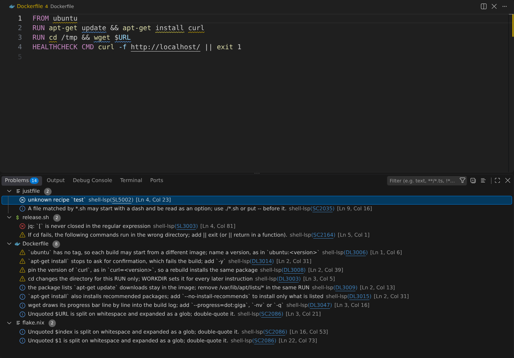
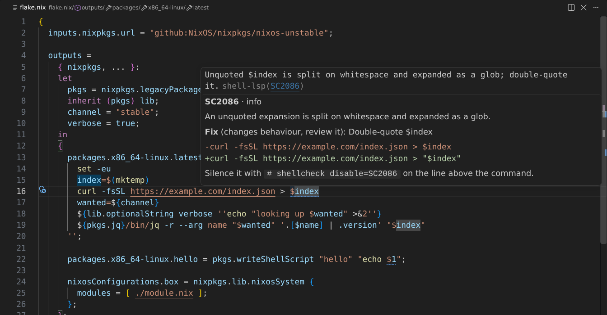
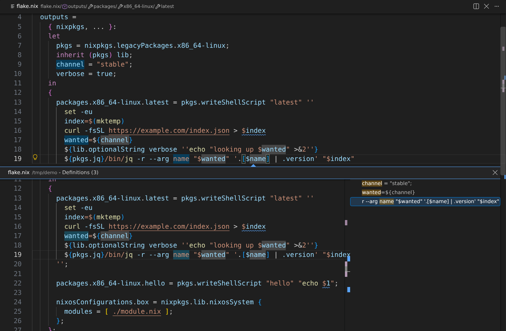
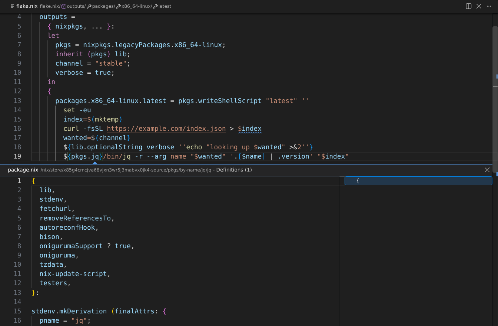
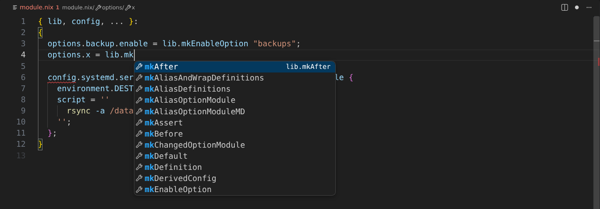
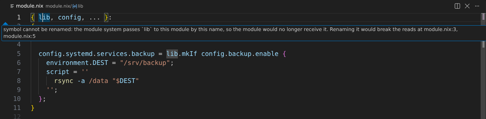
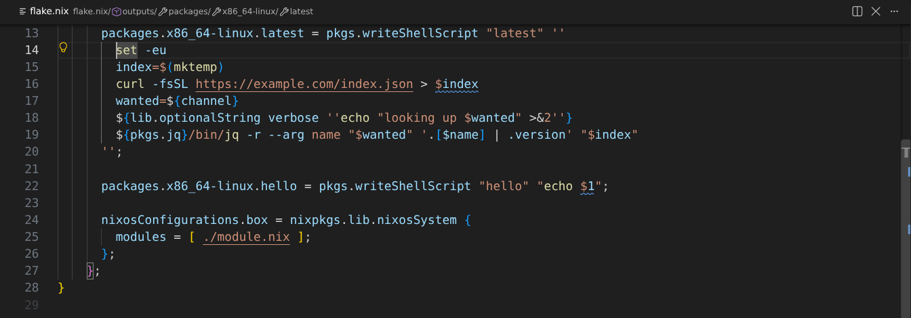
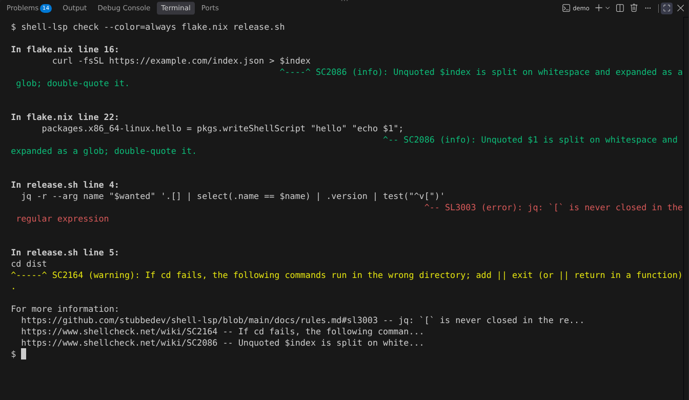
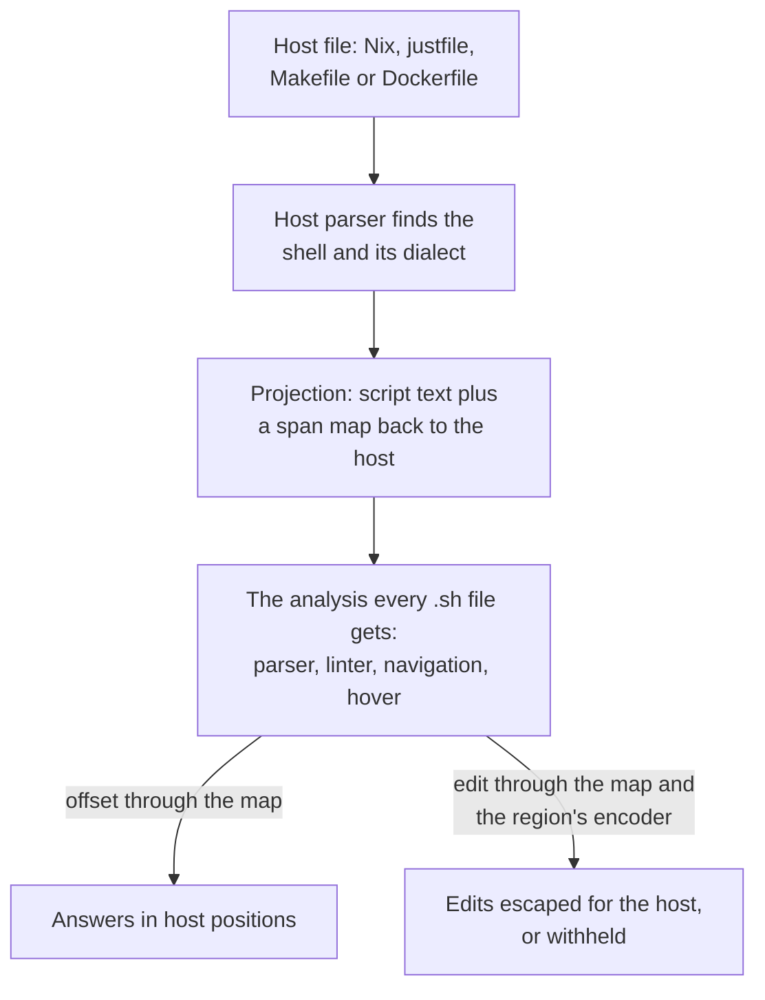

# shell-lsp

[](https://github.com/stubbedev/shell-lsp/actions/workflows/ci.yml)
[](https://github.com/stubbedev/shell-lsp/releases/latest)
[](LICENSE)

shell-lsp is a language server and command-line linter and formatter for shell
scripts (bash, zsh, POSIX sh, dash and ksh) and for the files that embed shell:
justfiles, Makefiles, Dockerfiles and Nix. It began as a shell server and grew
to follow shell into those files, and then to understand each of them as a
language of its own. A `.zsh` file and a `flake.nix` get the same depth.

- **Every shell by its own rules.** Each dialect has its own parser, and the
  dialect is detected per file from the shebang, a directive, `.shellcheckrc`
  or the file name. zsh is linted as zsh, which ShellCheck refuses to do.
- **Nix without an evaluator.** Flakes, module trees and overlays are followed
  from source, using 95 MiB at peak on an 89-file flake where nixd uses 576 MiB.
  [The comparison](#how-it-compares) says what that costs.
- **The languages are connected.** A recipe, a `RUN` instruction or a Nix string
  is linted and navigated as shell where it stands, and fixes are written back
  in the host's syntax. A jq program in a shell script in a Nix string is one
  chain, from `$name` in the jq program to its `--arg` flag, the shell variable
  and the Nix binding behind it.
- **One static binary replaces a toolbox.** The linter, the formatters and the
  manual-page reader are built in, so shellcheck, shfmt, man, Hadolint, statix,
  deadnix and nixfmt do not need to be installed. Their check codes, directives
  and flags keep working.
- **Compatibility is measured.** CI holds the linter to ShellCheck over a pinned
  corpus of 4,716 scripts, and the Nix formatter has 0 differences from nixfmt
  1.5.0 across all 44,765 files of nixpkgs.

## Quick start

Download the binary and lint a directory. This takes seconds and needs nothing
else (use `linux-arm64` or `darwin-arm64` for those platforms):

```sh
curl -fsSL -o shell-lsp https://github.com/stubbedev/shell-lsp/releases/download/v0.5.21/shell-lsp-v0.5.21-linux-amd64
chmod +x shell-lsp
./shell-lsp check -f gcc .
```

```text
Dockerfile:1:6: warning: `ubuntu` has no tag, so each build may start from a different image; name a version, as in `ubuntu:<version>` [DL3006]
Dockerfile:2:13: warning: `apt-get install` stops to ask for confirmation, which fails the build; add `-y` [DL3014]
Dockerfile:2:13: note: `apt-get install` also installs recommended packages; add `--no-install-recommends` to install only what is listed [DL3015]
Dockerfile:2:21: warning: pin the version of `curl`, as in `curl=<version>`, so a rebuild installs the same package [DL3008]
Makefile:4:28: note: Unquoted $f is split on whitespace and expanded as a glob; double-quote it. [SC2086]
Makefile:5:2: warning: If cd fails, the following commands run in the wrong directory; add || exit (or || return in a function). [SC2164]
flake.nix:13:53: note: Unquoted $index is split on whitespace and expanded as a glob; double-quote it. [SC2086]
justfile:4:23: error: unknown recipe `test` [SL5002]
justfile:9:16: note: A file matched by *.sh may start with a dash and be read as an option; use ./*.sh or put -- before it. [SC2035]
release.sh:4:81: error: jq: `[` is never closed in the regular expression [SL3003]
release.sh:5:1: warning: If cd fails, the following commands run in the wrong directory; add || exit (or || return in a function). [SC2164]
```

To use it in an editor, put the binary on `PATH` and [point your editor at
it](#editor-setup). In VS Code, `code --install-extension stubbedev.shell-lsp` is
enough; the extension offers to download the binary for you.

> [!TIP]
> The URL above names the version this README was released with. The [latest release](https://github.com/stubbedev/shell-lsp/releases/latest)
> has the current version, the other platforms and `SHA256SUMS`.

## Contents

- [See it work](#see-it-work): real examples in shell scripts, the files that
  embed them, and Nix
- [What it covers](#what-it-covers): the feature matrix per language
- [How embedded languages work](#how-embedded-languages-work)
- [Installation](#installation), [editor setup](#editor-setup) and the
  [command line](#command-line)
- [Configuration](#configuration)
- Languages: [shell scripts](#shell-scripts), [shell in other
  files](#shell-in-other-files) and [Nix](#nix-files)
- [Performance and memory](#performance-and-memory)
- [How it compares](#how-it-compares), with its limits
- [Documentation](#documentation): the full reference for every topic
- [How it was built](#how-it-was-built)

The documentation is also a [searchable site](https://stubbedev.github.io/shell-lsp/).

## See it work

Everything here is real output from v0.5.17 or later. `check` and `fmt` ran on these files,
and the editor answers came from driving the server over LSP: hover text as
returned, locations as `file:line:column`, edits applied and shown as diffs. The
screenshots are the VS Code extension on the same kind of files.

### In a shell script

#### zsh, linted as zsh

ShellCheck stops at a zsh shebang. Here the unquoted `$f`, which zsh neither
splits nor globs, is left alone, and what zsh would really do wrong is reported:

```zsh
#!/usr/bin/env zsh
read -r answer
if [[ $answer == (#i)y(es|) ]]; then
  print -r -- "syncing $match[1]"
  for f in *.conf(.N); do
    rsync $f host:
  done
fi
```

```console
$ shell-lsp check sync.zsh

In sync.zsh line 3:
if [[ $answer == (#i)y(es|) ]]; then
                 ^--^ SL2016 (warning): (#i) is an extended glob operator, and this file never runs `setopt extendedglob`, so zsh matches it literally.


In sync.zsh line 4:
  print -r -- "syncing $match[1]"
                        ^---^ SL2017 (warning): $match is only set by a pattern with (#b) or by =~, and nothing in this file uses either.

For more information:
  https://github.com/stubbedev/shell-lsp/blob/main/docs/rules.md#sl2016 -- (#i) is an extended glob operator...
  https://github.com/stubbedev/shell-lsp/blob/main/docs/rules.md#sl2017 -- $match is only set by a pattern w...
```

#### Patterns explained

The shell's own patterns are the hardest part of a script to read, so hover takes them
apart and, when the values are known from literal assignments, computes the result:

```zsh
#!/usr/bin/env zsh
setopt extendedglob
line='a=1 b=2'
print -r -- ${line//(#b)([^= ]##)=([^ ]#)/$match[2]:$match[1]}
```

```text
**line**: global variable

Declared on line 3:
line='a=1 b=2'

---

`${name//pattern/string}`: Replaces every match of `pattern` with `string`.

---

**Pattern**: every match, each as long as possible, is replaced.
- `(#b)`: Backreferences: every parenthesised group after this flag stores what it matched in `$match`, with offsets in `$mbegin` and `$mend`
- `([^= ]##)`: one or more of `[^= ]` (one character other than `=` or a space); captured in `$match[1]`
- `=`: the text `=`
- `([^ ]#)`: zero or more of `[^ ]` (one character other than a space); captured in `$match[2]`

---

**Result**: `1:a 2:b`

Given `line` = `a=1 b=2` (line 3).
```

#### A jq program in a script

awk, sed and jq programs in a script are parsed in place, and no jq binary is run:

```bash
#!/usr/bin/env bash
wanted=$1
curl -fsSL https://example.com/index.json |
  jq -r --arg name "$wanted" '.[] | select(.name == $name) | .version | test("^v[")'
cd dist
```

```console
$ shell-lsp check release.sh

In release.sh line 4:
  jq -r --arg name "$wanted" '.[] | select(.name == $name) | .version | test("^v[")'
                                                                                ^-- SL3003 (error): jq: `[` is never closed in the regular expression


In release.sh line 5:
cd dist
^-----^ SC2164 (warning): If cd fails, the following commands run in the wrong directory; add || exit (or || return in a function).

For more information:
  https://github.com/stubbedev/shell-lsp/blob/main/docs/rules.md#sl3003 -- jq: `[` is never closed in the re...
  https://www.shellcheck.net/wiki/SC2164 -- If cd fails, the following comman...
```

Hover on `$name`:

```text
`name` is set by `--arg name` on the command line of this jq program, as `"$wanted"`.
```

### In justfiles, Makefiles and Dockerfiles

#### A justfile recipe

The just syntax and the shell in its recipes are both understood, and each knows about
the other:

```just
version := "1.0"
export out_dir := "build"

package $target: lint test
    mkdir -p "$out_dir"
    cp "$target" "$out_dir/app-{{version}}"

lint:
    shellcheck *.sh
```

```console
$ shell-lsp check -f gcc justfile
justfile:4:23: error: unknown recipe `test` [SL5002]
justfile:9:16: note: A file matched by *.sh may start with a dash and be read as an option; use ./*.sh or put -- before it. [SC2035]
```

Renaming `$out_dir` from the shell edits the just variable and every read:

```diff
-export out_dir := "build"
+export dist_dir := "build"
-    mkdir -p "$out_dir"
-    cp "$target" "$out_dir/app-{{version}}"
+    mkdir -p "$dist_dir"
+    cp "$target" "$dist_dir/app-{{version}}"
```

A rename to a name the shell cannot read is refused
(`invalid name: "dist-dir" is not a valid variable name`). An inlay hint shows
`= "1.0"` after `{{version}}`, and the quick fix for the finding adds the recipe:

```diff
+
+test:
```

#### A Dockerfile

Hadolint's rules, BuildKit's checks and the shell in `RUN` report together. Here the Problems panel also holds what the other open files found:



#### Fixes written back in the host's syntax

A fix is computed on the shell and escaped for the place it lands in. In a Nix `"`
string a quote becomes `\"`, and in a Makefile `$f` stays `$$f`:

```diff
-  home.packages = [ (pkgs.writeShellScriptBin "hello" "echo $1") ];
+  home.packages = [ (pkgs.writeShellScriptBin "hello" "echo \"$1\"") ];
```

```diff
-	for f in *.c; do $(CC) -c $$f; done
+	for f in *.c; do $(CC) -c "$$f"; done
```

A fix that cannot be written there is not offered.

### In Nix

#### A script inside a Nix string

A `writeShellScript` string needs no marker to be read as shell, and findings land
on the line of the `.nix` file:

```nix
{
  inputs.nixpkgs.url = "github:NixOS/nixpkgs/nixos-unstable";

  outputs =
    { nixpkgs, ... }:
    let
      pkgs = nixpkgs.legacyPackages.x86_64-linux;
      channel = "stable";
    in
    {
      packages.x86_64-linux.latest = pkgs.writeShellScript "latest" ''
        index=$(mktemp)
        curl -fsSL https://example.com/index.json > $index
        wanted=${channel}
        ${pkgs.jq}/bin/jq -r --arg name "$wanted" '.[$name]' "$index"
      '';
    };
}
```

```console
$ shell-lsp check flake.nix

In flake.nix line 13:
        curl -fsSL https://example.com/index.json > $index
                                                    ^----^ SC2086 (info): Unquoted $index is split on whitespace and expanded as a glob; double-quote it.

For more information:
  https://www.shellcheck.net/wiki/SC2086 -- Unquoted $index is split on white...
```



#### From a jq variable to the Nix binding behind it

The last line of that script is three languages deep. Hover on `$name` in the jq
program shows the whole chain:

```text
`name` in this jq program is set by `--arg name`, as `"$wanted"`.
---
wanted
---
channel = "stable";
*variable*
```

Definition lists each step, from the flag to the shell variable to the Nix binding:

```text
flake.nix:15:36  name
flake.nix:14:9  wanted
flake.nix:8:7  channel
```



Renames stay honest about where a name lives. Renaming `$name` edits the flag and
its reads and leaves `$wanted` alone:

```diff
-        ${pkgs.jq}/bin/jq -r --arg name "$wanted" '.[$name]' "$index"
+        ${pkgs.jq}/bin/jq -r --arg pick "$wanted" '.[$pick]' "$index"
```

Renaming from the `${channel}` antiquotation in the shell edits the Nix binding:

```diff
-      channel = "stable";
+      track = "stable";
-        wanted=${channel}
+        wanted=${track}
```

#### A jump into nixpkgs, with nothing evaluated

Definition on `${pkgs.jq}` opens the package in the nixpkgs that `flake.lock` pins,
read from its source in the Nix store:

```text
file:///nix/store/x85g4cmcjva68vjxn3wr5j3mabvx0jk4-source/pkgs/by-name/jq/jq/package.nix:1:1
```

Hover there gives the package description, and on the `jq` of `/bin/jq` it says what
runs (``Runs the command `jq` of `jq`.``).



`lib.` completes from the same source:



> [!NOTE]
> This needs a `flake.lock` whose nixpkgs is in the store; without one `pkgs.jq` leads
> nowhere. Attributes that only exist after evaluation need
> [`nix.evaluate`](#where-it-falls-short).

#### A rename that refuses, and says why

The module system passes `lib` by name, so renaming it in a module would break the
module. Instead of doing that, the server names what would break:



An option the project declares does rename, across the class:

```diff
-  options.backup.enable = lib.mkEnableOption "backups";
+  options.archive.enable = lib.mkEnableOption "backups";
-  config.systemd.services.backup = lib.mkIf config.backup.enable {
+  config.systemd.services.backup = lib.mkIf config.archive.enable {
```

And `$DEST` in that unit's `script` leads to the attribute that sets it:

```text
environment.DEST = "/srv/backup";

Set in the environment by the unit's `environment`.

*variable*, exported to the shell
```

#### Colour across a splice

Semantic tokens follow the languages, so the Nix in `${...}`, the shell around it, the
nested string in `lib.optionalString` and the jq program are each coloured as what
they are:



#### Languages written from Nix

A string that Nix writes to a named file is read as that file's language, with its own
checks, at its place in the `.nix` file:

```nix
{ pkgs, ... }:
{
  home.file."project/justfile".text = ''
    deploy: build
        rsync -a out/ host:
  '';

  home.file."project/shell.nix".text = ''
    let unused = 1; in pkgs.mkShell { }
  '';
}
```

```console
$ shell-lsp check home.nix

In home.nix line 1:
{ pkgs, ... }:
  ^--^ SL8007 (info): the function never reads its argument `pkgs`

Did you mean:
{ ... }:


In home.nix line 4:
    deploy: build
            ^---^ SL5002 (error): unknown recipe `build`


In home.nix line 9:
    let unused = 1; in pkgs.mkShell { }
        ^----^ SL8005 (info): `unused` is bound but nothing that is read reads it
                       ^--^ SL8002 (error): `pkgs` is not defined here, so Nix rejects the file

Did you mean:
    let in pkgs.mkShell { }

For more information:
  https://github.com/stubbedev/shell-lsp/blob/main/docs/rules.md#sl5002 -- unknown recipe `build`
  https://github.com/stubbedev/shell-lsp/blob/main/docs/rules.md#sl8002 -- `pkgs` is not defined here, so Ni...
  https://github.com/stubbedev/shell-lsp/blob/main/docs/rules.md#sl8005 -- `unused` is bound but nothing tha...
```

### The command line

`check` reports what the editor shows, for every language at once:



`fmt` formats shell like shfmt, justfiles like `just --fmt` and Nix like nixfmt, and
leaves the shell in a Nix string as it is, so the string keeps its value:

```console
$ shell-lsp fmt -d b.nix
diff b.nix.orig b.nix
--- b.nix.orig
+++ b.nix
@@ -1,3 +1,13 @@
-{pkgs,...}: { x = [1 2 3]; y = {a=1;}; script = pkgs.writeShellScript "s" ''
+{ pkgs, ... }: {
+  x = [
+    1
+    2
+    3
+  ];
+  y = {
+    a = 1;
+  };
+  script = pkgs.writeShellScript "s" ''
     echo   hi
-''; }
+  '';
+}
```

## What it covers

Each cell was checked by asking the server. Every LSP method, in both directions, is
listed with its status in [docs/lsp-methods.md](docs/lsp-methods.md).

| Feature | Shell | Nix | justfile | Makefile | Dockerfile |
| --- | --- | --- | --- | --- | --- |
| Checks | `SC`, `SL` | `SL8`, and `SC` in strings | `SL5`, and `SC` in recipes | `SL6`, and `SC` in recipes | `SL7`, `DL`, and `SC` in `RUN` |
| Quick fixes | yes | yes | yes | yes | for the shell |
| Completion, hover | yes | yes | yes | yes | yes |
| Signature help | yes | yes | yes | yes | for the shell |
| Definition, references, highlight, rename | yes | yes | yes | yes | yes |
| Call hierarchy | yes | yes | yes | yes | no |
| Outline, workspace symbols | yes | yes | yes | yes | yes |
| Semantic tokens, folding, selection ranges | yes | yes | yes | yes | yes |
| Inlay hints | yes | yes | yes | yes | no |
| Document links | `source` paths | paths, URLs, flake inputs | `import`, `mod` | `include`, prerequisites | no |
| Code lenses | references, Bats "Run" | references, `nix build`, `nix run`, `nix flake check` | references, "▶ Run" | references, "▶ Run" | references |
| Formatting | shfmt's printer | nixfmt 1.5.0 | `just --fmt` | spacing only | no |
| Refactorings | [yes](#refactorings) | [yes](docs/nix.md#everything-else) | no | no | no |
| Reference tool it was compared with | ShellCheck, bash-language-server | nixd, nil, nixfmt, statix, deadnix | just 1.58 | GNU Make 4.4 | BuildKit 0.34, Hadolint 2.14 |

Programs embedded in a script are parsed in place, and no awk, sed or jq binary is run:

| In a shell string | awk | sed | jq |
| --- | --- | --- | --- |
| Syntax errors and regular expressions, at their exact position | [`SL3001`](docs/rules.md#sl3001) | [`SL3002`](docs/rules.md#sl3002) | [`SL3003`](docs/rules.md#sl3003) |
| Semantic tokens | yes | yes | yes |
| Hover | builtins | commands and flags | builtins |
| Completion, signature help | yes | no | yes |
| Variables bound on the command line | `-v`, `--assign` | no | `--arg`, `--argjson`, `--slurpfile`, `--rawfile` |

The linter has 459 `SC` checks, 143 `SL` checks and 54 `DL` checks, each listed with its
severity in [docs/checks.md](docs/checks.md).

## How embedded languages work

The shell in a Nix string is analysed by the same code as a `.sh` file. The host's parser
finds it, a *projection* builds a script from it with a map back to the file, and every
answer goes through that map on its way out.



The map is a list of spans, each saying what a piece of the script stands for in the host:

| Span | In the host | In the script | Example |
| --- | --- | --- | --- |
| Verbatim | Text the shell sees as written | The same text | `curl -fsSL` |
| Escape | A sequence of the host's string syntax | What it decodes to | `''$` in a Nix string is `$`; `$$` in a recipe is `$` |
| Stand-in | A value only the host knows | `$$`, one opaque word | `${channel}`, `$(CC)`, `{{version}}` |
| Program | A command word built by the host | The program's name | `${pkgs.jq}/bin/jq` reads as `jq`, so `jq` checks apply |
| Opaque | Nothing, or syntax to skip | Text the analysis needs | A subshell around each Makefile recipe line, since each line runs in a shell of its own |
| Indent | Indentation the host strips | Nothing | The leading spaces of a `''` string |

Stand-ins, programs and opaque spans cannot be edited. An edit that crosses one maps to
nothing, which is why a fix that would write into `${...}` is not offered. Each string has
an encoder for its syntax, so what lands in a `"` string is escaped differently from what
lands in a `''` string, and a set of edits that would empty the shallowest lines of a `''`
string, and so re-indent the rest, is withheld.

Maps compose. A justfile written by `home.file."x/justfile".text` is parsed from the decoded
string, and its recipe's shell goes through two maps on the way back to the `.nix` file.

## Installation

Pick one:

- **Release binaries** for Linux and Windows (amd64 and arm64) and macOS
  (arm64) are attached to every
  [GitHub release](https://github.com/stubbedev/shell-lsp/releases),
  together with a `SHA256SUMS` file. Download the one for your platform,
  check it with `sha256sum --check --ignore-missing SHA256SUMS` (on Windows,
  compare `Get-FileHash <file>` in PowerShell with its line), make it
  executable and put it on `PATH` as `shell-lsp` (`shell-lsp.exe` on
  Windows). [docs/editors.md](docs/editors.md#windows) lists what differs on
  Windows.
- **Go** 1.27.3 or newer: `go install github.com/stubbedev/shell-lsp@latest`
- **Nix**, which builds from source and runs the test suite: `nix profile install github:stubbedev/shell-lsp`, or try it with
  `nix run github:stubbedev/shell-lsp -- --version`
- **VS Code**: the [Shell LSP extension](editors/vscode)
  (`stubbedev.shell-lsp` on the Visual Studio Marketplace and Open VSX, and
  a `.vsix` on every release) runs the server, exposes its settings, and
  offers to download and verify the release binary when none is installed.

`shell-lsp --version` prints the installed version.

## Editor setup

The server speaks LSP over stdio and needs no arguments. Attach it to the file types you
want. [docs/editors.md](docs/editors.md) has the
rest: older Neovim, a statusline for the dialect, Windows, and what to turn off.

**VS Code** and VSCodium:

```sh
code --install-extension stubbedev.shell-lsp
```

The extension runs the server, exposes its settings and offers to download the binary.
See its [README](editors/vscode/README.md).

**Neovim** 0.11 and later:

```lua
vim.lsp.config("shell_lsp", {
  cmd = { "shell-lsp" },
  filetypes = { "sh", "bash", "zsh", "ksh", "make", "just", "dockerfile", "nix" },
  root_markers = { ".git" },
})
vim.lsp.enable("shell_lsp")
```

**Helix**, in `~/.config/helix/languages.toml`, with one `[[language]]` per language you want:

```toml
[language-server.shell-lsp]
command = "shell-lsp"

[[language]]
name = "bash"
language-servers = ["shell-lsp"]

[[language]]
name = "nix"
language-servers = ["shell-lsp"]
```

**Zed** launches `bash-language-server` for shell, so override its binary in `settings.json`:

```json
{
  "lsp": {
    "bash-language-server": {
      "binary": { "path": "shell-lsp", "arguments": [] }
    }
  }
}
```

> [!NOTE]
> Run it alone on the files it handles. With nixd, nil or a Dockerfile language server on the
> same files, the editor gets every answer twice.

## Command line

```
shell-lsp                        # serve LSP over stdio
shell-lsp check [OPTIONS] PATH   # lint, like shellcheck
shell-lsp fmt [FLAGS] [PATH]     # format, like shfmt
shell-lsp --version
```

`shell-lsp check` takes ShellCheck's options, `.shellcheckrc` files, output formats (plus SARIF
for code scanning) and exit codes, and `shell-lsp fmt` takes shfmt's flags, so both drop into CI
and pre-commit hooks where `shellcheck` and `shfmt` ran before, and report exactly what the editor
shows:

```sh
shell-lsp check .                        # lint every file it knows below .
shell-lsp check -f sarif . > out.sarif   # for GitHub code scanning
shell-lsp fmt -d .                       # show what formatting would change
shell-lsp fmt -w script.sh               # format in place
```

Flags, formats, CI and pre-commit recipes are in [docs/cli.md](docs/cli.md).

## Configuration

Settings arrive as `initializationOptions`, as the `shellLsp` section of
`workspace/didChangeConfiguration`, and, when the client supports `workspace/configuration`, are
pulled for the whole workspace and for each workspace folder; a document uses the settings of the
innermost folder that contains it. Unknown keys and invalid values are rejected with an error naming
the offending field.

```json
{
  "dialect": "bash",
  "lint": {
    "enable": true,
    "exclude": ["SC2034"]
  }
}
```

<details>
<summary>Every setting</summary>

| Key | Default | Meaning |
| --- | --- | --- |
| `dialect` | detected per file | Force `bash`, `zsh`, `sh`, `dash`, `ksh` or `busybox` for every document |
| `lint.enable` | `true` | Report lint findings alongside syntax errors |
| `lint.profile` | `recommended` | How much to report: `recommended`, `minimal` or `strict` |
| `lint.exclude` | `[]` | Codes to suppress, as `SC2034` or `2034` |
| `lint.optional` | `[]` | Opt-in checks to enable by name, such as `require-variable-braces`, or `all` |
| `format.enable` | `true` | Answer formatting requests |
| `format.indent` | editor setting | Spaces per level; `0` indents with tabs |
| `format.binaryNextLine` | `false` | Put `&&`, `\|\|` and `\|` at the start of continuation lines |
| `format.switchCaseIndent` | `false` | Indent `case` arms inside `case ... esac` |
| `format.spaceRedirects` | `false` | Write `> file` instead of `>file` |
| `format.functionNextLine` | `false` | Put the opening brace of a function on its own line |
| `format.simplify` | `false` | Apply shfmt's simplifications (like `shfmt -s`) |
| `format.minify` | `false` | Minify the script (like `shfmt -mn`) |
| `nix.evaluate` | `false` | Evaluate flakes with `nix` to complete and describe NixOS, home-manager and flake-parts options and nixpkgs attributes |

</details>

How `.editorconfig` and the `format.*` settings interact is in [docs/formatting.md](docs/formatting.md).

## Languages

### Shell scripts

An error-tolerant parser for each dialect, with incremental document sync, sits behind diagnostics,
completion, hover, navigation, rename, call hierarchy, symbols, semantic tokens, inlay hints,
signature help, folding, selection ranges and code lenses, across the files a script sources. Details
are in [docs/shell.md](docs/shell.md), including [patterns and
expansions](docs/shell.md#patterns-and-expansions), [sourced files](docs/shell.md#sourced-files),
[embedded awk, sed and jq](docs/shell.md#embedded-languages) and [Bats](docs/shell.md#bats).

#### Dialects

Each document is linted as one shell. The first of these that applies decides which:

1. the `dialect` setting;
2. `shell=` in the nearest `.shellcheckrc`;
3. `shell_variant` in `.editorconfig`;
4. a `# shellcheck shell=` directive in the comment header before the first
   command;
5. the shebang, also behind `env`, `busybox` and `nix-shell -i`, and with
   the interpreter's version in its name (`bash5`, `zsh-5.9`);
6. a zsh completion tag (`#compdef`, `#autoload`) on the first line;
7. the file name (`.bashrc`, `.zshrc`, `.profile` and the other rc files) or
   its extension (`.bash`, `.bats`, `.zsh`, `.dash`, `.sh`, `.ksh`);
8. the editor's language identifier, unless it is the generic `shellscript`;
9. a vim modeline (`# vim: ft=zsh`);
10. otherwise bash.

An extension or the bash default is only a guess, and a wrong guess is the usual cause of findings
that make no sense for the shell you use. When nothing names the shell at all, SC2148 says so, in the
editor as in `shell-lsp check`. The VS Code extension shows the shell in the status bar with what
decided it, and clicking it records your choice as a `# shellcheck shell=` directive, which every
editor and `shell-lsp check` then follow.

The parser understands the whole grammar of each shell, including zsh's
short and brace forms of loops and `if`, `foreach`, `repeat`,
`{ } always { }`, anonymous functions with arguments and glob qualifiers,
and ksh93's compound variables and types, `namespace` and dotted names. A
ksh script is parsed as ksh93 unless its shebang, shell directive or file
name says mksh.

<details>
<summary>Requests for clients that show or set the dialect</summary>

| Request | Params | Result |
| --- | --- | --- |
| `shellLsp/documentDialect` | `{textDocument, position?}`; with a position in a justfile, Makefile or Nix file, the shell of the recipe or string there | `{selectable, dialect, source, evidence, guessed, description}`, plus `{directive, dialects}` when `selectable` is `true`: whether a directive can choose the shell (`false` for [shell in other files](#shell-in-other-files), whose host decides it), the shell, what decided it (`default`, `override`, `shellcheckrc`, `editorconfig`, `directive`, `shebang`, `completionTag`, `fileName`, `extension`, `languageId`, `modeline`, or for shell in other files `hostSetting` and `hostDefault`), the text that did, whether that is a guess, a sentence to show, whether a header shell directive exists, and the shells that can be chosen |
| `shellLsp/setDialect` | `{textDocument, dialect}` | The `WorkspaceEdit` that adds or updates the header directive for `dialect`, or removes it when `dialect` is `null`; `null` when nothing changes; an error for shell in other files |

</details>

#### Completion and hover

Completion and hover cover builtins, keywords, functions, variables, paths, and the options and
subcommands of installed commands; [docs/shell.md](docs/shell.md#completion-and-hover) has the
shell's own vocabulary.

Documentation for external commands comes from the installed manual pages,
which the server locates through `MANPATH` (where it is unset or has an
empty entry, in the `share/man` and `man` directories next to every `PATH`
entry and in `/usr/share/man`, `/usr/local/share/man`, `/usr/local/man` and
`/opt/homebrew/share/man`), decompresses and renders itself; neither `man`
nor groff is involved. Subcommands come from the same pages: after `git`,
`systemctl` or `docker` completion offers the documented subcommands, and
the flags completed and hovered after `git checkout` are those of
git-checkout(1), falling back to the command's own page. Nested subcommands
such as `git remote add`, `kubectl config set-context` or `ip link set`
resolve as deep as the pages document them, global options before a
subcommand are skipped with their values (`git -C dir checkout`,
`kubectl -n ns get`), and commands behind the wrappers `builtin`, `busybox`,
`command`, `doas`, `env`, `exec`, `nice`, `nohup`, `setsid`, `sudo`, `time`,
`timeout`, `watch` and `xargs` complete and hover as if typed directly.

#### Linting

The linter uses ShellCheck's check codes and honours `# shellcheck` directives, so existing scripts
and annotations carry over. It also lints zsh, by zsh's own rules, and follows sourced files without
flags. Quick fixes are either safe, keeping the script's behaviour, or marked for review, and fix-all
applies only the safe ones. Checks that go beyond ShellCheck use `SL` codes. See
[docs/linting.md](docs/linting.md), and [docs/rules.md](docs/rules.md) for the rules.

#### Profiles

`lint.profile` (or `--profile` for `shell-lsp check`) sets how much is
reported:

- `recommended`, the default, runs every check that is on by default.
- `minimal` keeps errors, warnings, and the informational checks that point at
  a real bug: the script can print the wrong thing, lose data, run the wrong
  command or fail on input it can plausibly meet, such as an unquoted `$var`
  (`SC2086`) or `A && B || C` used as if-then-else (`SC2015`). Style notes,
  portability notes below warning level, deprecations and redundancies are
  left out. [docs/checks.md](docs/checks.md) marks every check `minimal` keeps.
- `strict` also turns on every optional check except
  `check-unassigned-uppercase`, which reports every all-uppercase variable a
  script reads without assigning, so it flags ordinary environment inputs
  such as `$HOME` or `$CI` rather than mistakes, and
  `avoid-global-reassignment` and the `google-` checks, which follow one
  style guide's preferences rather than point at mistakes.

The profile is the starting point, and the other settings apply on top:
optional checks named in `lint.optional` or turned on with a `# shellcheck
enable=` directive always run and are reported in every profile, codes in
`lint.exclude` are never reported, and `disable=` directives silence findings
as usual. `.shellcheckrc` files have no profile key, so they stay compatible
with ShellCheck.

#### Refactorings

Code actions offered at the cursor or selection, each only where it applies and keeps the script's
meaning; their edits are computed on `codeAction/resolve` when the client supports it, and an action
that edits another file as well carries a change annotation asking the client to confirm it, so
editors that support annotations show a preview first.

<details>
<summary>Every refactoring</summary>

| Action | Kind | What it does |
| --- | --- | --- |
| Extract to variable | `refactor.extract` | Moves the selected word or part of a word into a variable |
| Extract to function | `refactor.extract` | Moves the selected statements into a new function |
| Toggle quotes | `refactor.rewrite` | Converts between single and double quotes |
| Remove the quotes | `refactor.rewrite` | Unquotes a quoted literal made only of letters, digits and `_ . / : @ % + -`, which the shell reads the same either way; not offered for a command name, a here-document delimiter or inside arithmetic |
| Declare as local | `refactor.rewrite` | Adds `local` to an assignment inside a function |
| Convert backticks | `refactor.rewrite` | Rewrites `` `cmd` `` as `$(cmd)`, undoing the backquote escaping |
| Convert to `[[ ]]` | `refactor.rewrite` | Rewrites `[ ... ]` or `test ...` in bash, zsh and ksh, turning `-a`, `-o`, `\(`, `\)`, `\<` and `\>` into `&&`, `\|\|`, `(`, `)`, `<` and `>`; skipped when globs or unquoted expansions would be read differently |
| Inline variable | `refactor.inline` | Replaces the reads of a variable assigned once to a literal with the value, quoted for each place it is read, and removes the assignment; only when nothing else writes, exports, unsets or could read the variable before the assignment or from another scope. A word spelling the name counts as harmless only as an argument of `echo`, `cd`, `pwd`, `type`, `true`, `false`, `:` or (in bash and sh) an external command, or as a redirection target; `eval`, `trap` and `alias` block it unless all their arguments are literals that never mention the name; and `source`/`.` blocks it only when a sourced file, followed transitively, cannot be resolved or touches the variable outside its own `local`s |
| Toggle the function keyword | `refactor.rewrite` | Switches between `function f { ... }` and `f() { ... }` when the cursor or selection is on the keyword, the name or its `()`; the keyword form is only offered in bash and zsh, and ksh is left alone because there the two forms scope variables differently |
| Add strict mode | `source.strictMode` | Adds whatever part of `set -euo pipefail` (`set -eu` in sh, dash and busybox) a script does not already enable, counting shebang flags, `set -o` names and zsh's `setopt err_exit`, `no_unset` and `pipe_fail` in any case or underscore spelling; it extends the first top-level `set` or `setopt` line that enables some of them, or else inserts a `set` line after the shebang and leading comments |
| Add shebang | `source.shebang` | Inserts the interpreter line for the detected shell (`#!/usr/bin/env bash`, `#!/bin/sh`, ...) into a script that has none; not offered for Bats files or zsh completion functions, whose first line must stay `#compdef` or `#autoload` |
| Convert to case | `refactor.rewrite` | Rewrites an `if`/`elif` chain whose every condition compares the same expansion for equality (`[ "$x" = lit ]`, `test`, `[[ $x == pattern ]]`, joined with `\|\|` or `-o`) into `case`, keeping each body and the `else` branch; one-line chains and `then`, `else` or `fi` sharing a line with commands are split onto their own lines, and the arms follow the document's tab or space indentation (falling back to the configured `indent`) and the `switchCaseIndent` / `switch_case_indent` setting |
| Move function to a sourced file | `refactor.move` | Moves a top-level function, with the comment block directly above it, to the end of a workspace file this script sources before defining the function, as one edit across both files; not offered when the target file is written for another shell that would not parse the function or that the portability checks (`SC3xxx`) flag it for, such as bash syntax moving into an sh, dash or busybox file |

</details>

### Shell in other files

Makefile and justfile recipes, Dockerfile `RUN`, `CMD`, `ENTRYPOINT` and `HEALTHCHECK CMD`
instructions, and Nix strings hold shell that something else runs. It is linted and navigated where
it stands, as the shell the file decides, and every edit is written back in the file's syntax. Each
Makefile or justfile recipe line runs in a shell of its own, as make and just run it.

<a name="justfiles-makefiles-and-dockerfiles-natively"></a>
The just, make and Dockerfile syntax around that shell has parsers of its own: diagnostics, navigation
across `import`, `mod` and `include`, the boundary between a recipe's shell and the variables it reads,
call hierarchy, signature help, inlay hints, quick fixes, completion, hover, an outline, "▶ Run" lenses
and formatting. Dockerfiles are checked the way BuildKit checks them and with Hadolint's rules, pragmas
and `.hadolint.yaml`. The full rules are in [docs/hosts.md](docs/hosts.md) and
[docs/hadolint.md](docs/hadolint.md).

### Nix files

[docs/nix.md](docs/nix.md) is the full reference. In short:

- **Shell strings are found by where they stand**: phases and hooks, writers, `runCommand`, systemd
  units, NixOS and home-manager options read from a pinned nixpkgs and home-manager, named files by
  their shebang or name, a `/* bash */` comment, and through functions in the same file or a wrapper in
  another. [The table of places](docs/nix.md#which-strings-are-shell).
- **The shell reads the Nix around it.** A phase knows the derivation's attributes, a unit its
  `environment`, and `${pkg}/bin/foo` is the program `foo`. [Variables](docs/nix.md#variables-the-nix-around-a-script-sets).
- **The Nix language answers across a project.** Imports, `callPackage`, flake inputs, overlays and
  module classes are followed from source. `lib.x` and `pkgs.x` are read from the locked nixpkgs.
  [The Nix language](docs/nix.md#the-nix-language).
- **A rename refuses what it cannot prove**, with the reason and the place.
  [Rename](docs/nix.md#rename).
- **Checks with fixes**: the lints of statix and the findings of deadnix as `SL8` codes, honouring
  `statix.toml` and `# deadnix: skip`. [The list](docs/rules.md#statix-and-deadnix-compatibility).
- **Languages written from Nix** get their own checks and navigation inside the string.
  [Details](docs/nix.md#languages-written-from-nix).

## Performance and memory

### Editing

A keystroke with `BenchmarkKeystroke` in `internal/server`, in the numbers the v0.5.17 release notes give for
that release's change:

| Keystroke | Before | After |
| --- | ---: | ---: |
| 700 scripts, editing outside them | 41 ms | 14 ms |
| 700 scripts, typing in one | 41 ms | 20.5 ms |
| Plain 5,000-line Nix file | 45.8 ms | 43 ms |

Findings for a script whose text did not change are reused, and that was verified against a full
recompute over a 600-edit replay. The test suite holds keystrokes to allocation budgets and parsing and
completion to time budgets, and `GOGC` overrides the collector's pacing if you want to trade CPU for memory.

### Shell

`shell-lsp check` lints the 1,219 `*.sh` and `*.bash` files of the pinned nixpkgs in 0.18 s
on 12 cores (1.2 s of CPU). One `shellcheck` process over the same files takes 20.7 s. The rule sets differ,
so read that as an order of magnitude, not a like-for-like benchmark.

### Nix

Measured with `cmd/nixparity`, which runs both servers over the same files, one after the other and
one request at a time. Peak RSS sums the server's process group, sampled every 250 ms; idle RSS samples
it again three seconds after the last request.

| Workspace | Measure | shell-lsp | nixd | nil |
| --- | --- | ---: | ---: | ---: |
| 89-file flake | Peak | 95 MiB | 576 MiB | 380 MiB |
| 89-file flake | Idle | 68 MiB | 562 MiB | 58 MiB |
| nixpkgs | Peak | 145 MiB | 394 MiB | 12 MiB |
| nixpkgs | Idle | 85 MiB | 389 MiB | 11 MiB |

> [!NOTE]
> nil's nixpkgs figures are not a comparison: nil doesn't index a project. nixd also spends part of its
> memory on evaluating, which shell-lsp does not do unless [`nix.evaluate`](#where-it-falls-short) is on.

To reproduce it, `just nix-parity-large [PATH] [nixd|nil]` runs the comparison on a flake, or on the
pinned nixpkgs when no path is given. The method, sampling and outcomes are described in
[docs/corpus.md](docs/corpus.md#latency-memory-and-failures).

The formatter has 0 differences from nixfmt 1.5.0 across all 44,765 `.nix` files of nixpkgs, both as written
and with their layout destroyed three different ways.

## How it compares

| Tool | What shell-lsp takes over | Evidence | What differs |
| --- | --- | --- | --- |
| [ShellCheck](https://github.com/koalaman/shellcheck) | Check codes, directives, `.shellcheckrc`, options, formats, exit codes | Over 4,716 corpus scripts, [`corpus/shellcheck.md`](corpus/shellcheck.md): 54,290 findings agree, 10,225 only ours, 3,250 only ShellCheck's | Its own messages and `SL` checks, and it lints zsh. [All differences](docs/cli.md#differences-from-shellcheck) |
| [shfmt](https://github.com/mvdan/sh) | Printer, flags, `.editorconfig` keys | Built on a fork of the same library | [Also formats](docs/formatting.md) justfiles, Makefiles and Nix |
| [bash-language-server](https://github.com/bash-lsp/bash-language-server) | Everything it offers, for every dialect | Completion recall 135/137 against 123/137, [`docs/crosscheck.md`](docs/crosscheck.md) | Lints without an external shellcheck |
| [nixd](https://github.com/nix-community/nixd) | Navigation, completion, hover, rename, formatting | Compared question by question with `cmd/nixparity`, [`docs/corpus.md`](docs/corpus.md#nix-server-parity) | Nothing is evaluated by default, see below. Deliberate differences are [listed](docs/corpus.md#differences-that-are-decided) |
| [nil](https://github.com/oxalica/nil) | The same | The same | Reads the whole project, where nil does not; no type inference on hover |
| [statix](https://github.com/molybdenumsoftware/statix), [deadnix](https://github.com/astro/deadnix) | Lints and findings, `statix.toml`, `# deadnix: skip` | On 2,500 nixpkgs files, [`corpus/nix-lint.md`](corpus/nix-lint.md): 676 agree, 65 only ours, 0 only theirs | [Details](docs/rules.md#statix-and-deadnix-compatibility) |
| [nixfmt](https://github.com/NixOS/nixfmt) | Output, byte for byte | 0 differences across 44,765 files | Default width and indent only |
| [Hadolint](https://github.com/hadolint/hadolint) | `DL` codes, pragmas, `.hadolint.yaml` | More than 500 Dockerfiles run through it | [Deliberate differences](docs/hadolint.md) |

### Where it falls short

- **fish and csh are not supported.** Scripts whose shebang names them are reported as unsupported.
- **Dockerfiles are not formatted**, and Dockerfile findings have no quick fixes of their own beyond the shell's.
- **Large projects stop being followed**: past 4096 files or 8 MiB of source, and a workspace scan stops at 20000
  files. A rename that has to know every reader is then refused.
- **Prebuilt binaries** cover Linux and Windows on amd64 and arm64 and macOS on arm64.
- **`nix.evaluate` is off by default and needs Nix.** Without it nothing is evaluated, so generated `pkgs`
  attributes get no answer. `pkgs.nerd-fonts.jetbrains-mono`, members of a set `callPackage` builds such as
  `pkgs.writers.writePython3`, and the versions nixd shows as inlay hints all need the setting. nixd answers
  these out of the box, since it evaluates `<nixpkgs>` on its own. Turning it on can fetch the flake's inputs
  over the network, uses CPU for as long as an evaluation runs and keeps results in a disk cache. It requires
  Nix 2.24 or newer, Lix 2.95 or newer, or Determinate Nix based on Nix 2.24 or newer.
- **nixd and nil still answer some questions shell-lsp does not.** Sampling keeps finding a few; those read so
  far are recorded by class in [docs/corpus.md](docs/corpus.md#differences-that-are-decided), along with the
  cases where the difference is deliberate.
- **`pkgs.x` needs a `flake.lock`** whose nixpkgs is in the store, or a file inside a nixpkgs checkout.
  `nix-shell -p x` leads to `x` only where one of the project's overlays sets it.
- **Shell that Nix assembles across `${...}`**, such as a `case` whose patterns come from `lib.optionalString`,
  cannot be checked, and may be reported as a syntax error.
- **A string passed to a wrapper in another file** is linted only after a background pass has proven it.
- **Some variables stdenv reads**, such as `dontPatchShebangs`, still report `SC2034`.

## Documentation

| Topic | Page |
| --- | --- |
| Editors, Windows, commands for client authors | [docs/editors.md](docs/editors.md) |
| `check` and `fmt`, CI, pre-commit | [docs/cli.md](docs/cli.md) |
| Formatting and `.editorconfig` | [docs/formatting.md](docs/formatting.md) |
| Completion, patterns, sourced files, embedded languages, Bats | [docs/shell.md](docs/shell.md) |
| Quick fixes, directives, `.shellcheckrc` | [docs/linting.md](docs/linting.md) |
| Every check, and `SL` rules in depth | [docs/checks.md](docs/checks.md), [docs/rules.md](docs/rules.md) |
| Justfiles, Makefiles, Dockerfiles | [docs/hosts.md](docs/hosts.md), [docs/hadolint.md](docs/hadolint.md) |
| Nix | [docs/nix.md](docs/nix.md) |
| LSP methods | [docs/lsp-methods.md](docs/lsp-methods.md) |
| Comparisons with the reference tools | [docs/corpus.md](docs/corpus.md), [docs/crosscheck.md](docs/crosscheck.md) |
| Working on shell-lsp | [docs/development.md](docs/development.md), [docs/vscode-publishing.md](docs/vscode-publishing.md) |
| Release notes | [Releases](https://github.com/stubbedev/shell-lsp/releases) |

## How it was built

AI agents wrote the code, the tests and the documentation. The author chose what to build and how far to
take it, set the design rules the code has to follow, and decided what landed. Correctness rests mainly on
checks anyone can rerun, rather than on line-by-line review: tests derived from what the reference tools
observably do, real shells settling disagreements, and the same gates for every change.

ShellCheck, bash-language-server, Hadolint and the Nix tools were treated as black boxes;
[CLEAN_ROOM.md](CLEAN_ROOM.md) states what may and may not be used. Parsing and shell formatting reuse a fork
of [mvdan.cc/sh](https://github.com/mvdan/sh) under its BSD license, in [third_party/mvdan-sh](third_party/mvdan-sh).
The full account is in [docs/how-it-was-built.md](docs/how-it-was-built.md), and how to work on it in
[docs/development.md](docs/development.md).

## License

[MIT](LICENSE)
