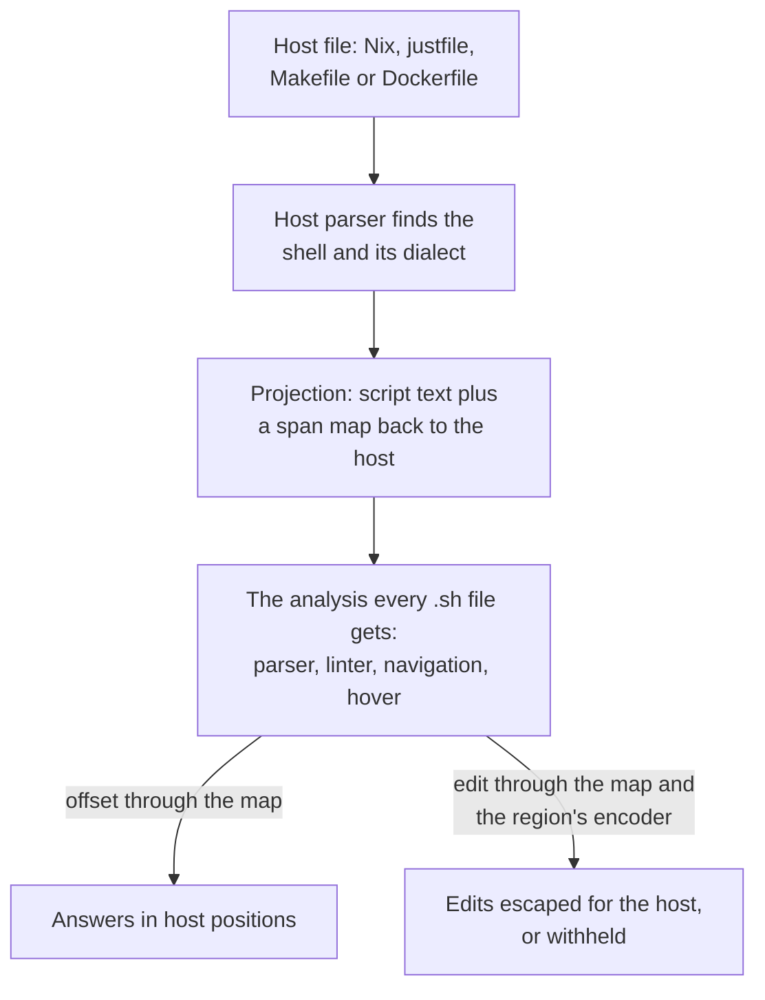

# Justfiles, Makefiles and Dockerfiles

shell-lsp reads these files twice: the shell they hold, and the language around
it. This page is the full reference; the
[README](../README.md#see-it-work) has examples. The checks are
listed in [rules.md](rules.md#sl5001), and [hadolint.md](hadolint.md) covers
Hadolint's rules.

## Shell in other files

Some files that are not shell scripts hold shell that something else runs.
shell-lsp lints and navigates that shell where it stands: it extracts it into
a script with a map back to the file, analyses the script like any other, and
answers in positions of the file. Every edit, from a quick fix to a rename,
is written back in the syntax of the file; a fix that cannot be written there,
such as one that would need a new line in a Makefile recipe, is not offered.
The shell cannot be switched with a `# shellcheck shell=` directive, because
the file decides it. A `# shellcheck disable=` directive in the shell works as
usual. Nix files, justfiles, Makefiles and Dockerfiles are also understood as
languages of their own
([Nix files](nix.md),
[Justfiles, Makefiles and Dockerfiles natively](#justfiles-makefiles-and-dockerfiles-natively)).

An editor sends these files when the server is attached to their file type
([editors.md](editors.md)); `shell-lsp check` and the workspace scan
find them by name.

### How the shell is mapped

The shell in a host file is analysed by the same code as a `.sh` file. The host's parser
finds it, a *projection* builds a script from it with a map back to the file, and every
answer goes through that map on its way out.

The map is a list of spans, each saying what a piece of the script stands for in the host:

| Span | In the host | In the script | Example |
| --- | --- | --- | --- |
| Verbatim | Text the shell sees as written | The same text | `curl -fsSL` |
| Escape | A sequence of the host's string syntax | What it decodes to | `''$` in a Nix string is `$`; `$$` in a recipe is `$` |
| Stand-in | A value only the host knows | `$$`, one opaque word | `${channel}`, `$(CC)`, `{{version}}` |
| Program | A command word built by the host | The program's name | `${pkgs.jq}/bin/jq` reads as `jq`, so `jq` checks apply |
| Opaque | Nothing, or syntax to skip | Text the analysis needs | A subshell around each Makefile recipe line, since each line runs in a shell of its own |
| Indent | Indentation the host strips | Nothing | The leading spaces of a `''` string |

Stand-ins, programs and opaque spans cannot be edited. An edit that crosses one maps to
nothing, which is why a fix that would write into `${...}` is not offered. Each string has
an encoder for its syntax, so what lands in a `"` string is escaped differently from what
lands in a `''` string, and a set of edits that would empty the shallowest lines of a `''`
string, and so re-indent the rest, is withheld.

Maps compose. A justfile written by `home.file."x/justfile".text` is parsed from the decoded
string, and its recipe's shell goes through two maps on the way back to the `.nix` file.

### Makefiles

A document is a Makefile when it is named `Makefile`, `makefile` or
`GNUmakefile` or ends in `.mk` or `.mak`, whatever language identifier the
editor gives it, or else when its language identifier is `makefile` or
`make`.

- The recipes are the shell: the lines that start with the recipe prefix
  (a tab, or `.RECIPEPREFIX`) after a rule, and the recipe after `;` on the
  rule line, with their backslash continuations. Make syntax around them
  (variables, conditionals, `define` bodies, comments) is not shell and is
  skipped.
- The `@`, `-` and `+` prefixes are dropped, `$$` is the shell's `$`, and
  every make expansion (`$(CC)`, `${FLAGS}`, `$@`, `$(call f,x)`) stands for
  text the shell sees but no one can know in advance, so it is neither a
  constant nor split into words. Fixes write a `$` back as `$$`.
- Each recipe line runs in a shell of its own, as make runs it, so a variable
  set or a `cd` on one line does not reach the next (`SC2030`, `SC2031`), and
  a syntax error stays on its line. With `.ONESHELL`, each recipe is one
  script.
- The shell is the one `SHELL` names, also behind `env`; without `SHELL` it
  is `sh`. The options in `.SHELLFLAGS` (`-e`, `-u`, `-o pipefail`), or the
  `-e` a `.POSIX` target implies, are set in every recipe. A target-specific
  `SHELL` (`test: SHELL := /bin/bash`) decides the shell of that target's
  recipe, which is checked as its own shell. When `SHELL` names something
  that is not a shell, or is computed (`$(shell ...)`, `!=`), the recipes it
  runs are not analysed.
- A directive goes on a recipe line of its own, indented like the recipe
  (`# shellcheck disable=SC2086`), and applies to the next line.
- A make expansion inside single quotes (`'$(VAR)'`) is still text the shell
  cannot know, not a literal `$`. A shell variable assigned from an expansion
  holds that unknown text, so leaving it unquoted is SC2086.
- Shell checks read each recipe alone and reuse the report of a recipe that did
  not change. Exported variables reach every recipe with a value it cannot
  know, so an unquoted `$$NAME` of one gets SC2086 and reading it is not reading
  an unset variable; what one recipe assigns or defines does not reach another.
  A word that is only `$(macro)` may run anything, so its recipe is not told a
  variable is unused or unassigned.

### justfiles

A document is a justfile when it is named `justfile`, `Justfile`, `JUSTFILE`
or `.justfile` or ends in `.just`, whatever language identifier the editor
gives it, or else when its language identifier is `just`.

- The recipe bodies are the shell. The settings, variables, aliases,
  attributes and recipe headers around them are not.
- A recipe without a shebang runs each line in a shell of its own, as just
  runs it, after dropping the `@` and `-` sigils and joining lines that end in
  `\`. A recipe that starts with a shebang, or has the `[script]` attribute,
  is one script.
- `{{expression}}` stands for text no one can know in advance, also inside
  quotes, and `{{{{` is a literal `{{`. Fixes write `{{` back as `{{{{`, and
  only a script recipe takes a fix that needs a new line, indented like the
  recipe. A shell variable assigned from one holds that unknown text, so leaving
  it unquoted is SC2086.
- Exported variables (`export name := ...`, `set export`) and `$`
  parameters are set when a recipe runs, to a value that can hold spaces, so
  reading them is not reading an unset variable and leaving them unquoted is
  SC2086.
- A recipe's shell is the one its shebang names, else the one its
  `[script(...)]` attribute or `set script-interpreter` names for a script
  recipe, else the one `set shell` names, else `sh`. Recipes run by something
  that is not a shell, and `[windows]` recipes when `set windows-shell` or
  `set windows-powershell` is given, are not analysed. Each recipe is parsed
  and checked as its own shell, so a bashism in a plain recipe is reported
  even when another recipe is bash, and hover, completion and the dialect
  status follow the recipe under the cursor.
- Shell checks read each recipe alone and reuse the report of a recipe that did
  not change. Exported variables reach every recipe, and a `$` parameter its
  own; what one recipe assigns or defines does not reach another. A word that
  is only `{{expression}}` may run anything, so its recipe is not told a
  variable is unused or unassigned.

### Dockerfiles

A document is a Dockerfile when it is named `Dockerfile` or `Containerfile`,
starts with `Dockerfile.` or `Containerfile.` or ends in `.Dockerfile`,
`.dockerfile` or `.Containerfile`, whatever language identifier the editor
gives it, or else when its language identifier is `dockerfile`. A file ending
in `.dockerignore`, such as `Dockerfile.dockerignore`, is the ignore file of a
Dockerfile and not one itself.

- The shell form of `RUN`, and the heredocs a `RUN` feeds to its shell, are
  the shell; so are the shell forms of `CMD`, `ENTRYPOINT`, a
  `HEALTHCHECK CMD` and the instructions `ONBUILD` triggers. JSON forms (`RUN ["make"]`) run no shell and are skipped,
  as is a heredoc whose first line is a shebang of something that is not a
  shell.
- Each instruction runs in a shell of its own, as BuildKit runs it, with the
  continuation lines joined and the comments between them dropped.
- The shell is the one the last `SHELL` or `# hadolint shell=` pragma before
  the instruction names, in the stage or the stages it is built `FROM`, else
  `sh`; a heredoc with a shebang runs in that one. Each shell is checked as its
  own, and a `RUN` in a shell that is not one, such as PowerShell, is left alone.
- The `ENV` variables of the stage and its base stages, and the `ARG`s it
  declares, are set when the shell runs. As in any script, reading an
  all-uppercase variable that is never set is not reported (`SC2154`), which
  leaves alone what the base image sets, such as `PATH` or `GOPATH`.

## Justfiles, Makefiles and Dockerfiles natively

Beyond the shell in their recipes, shell-lsp reads the just, make and
Dockerfile syntax around it with parsers of its own, so it is the only server
an editor needs for these files.

- **Diagnostics.** Syntax errors, unknown recipes, targets, variables,
  functions, settings and attributes, wrong argument counts, duplicates,
  circular dependencies and recursive variables, unused parameters and
  variables, missing `import`, `mod` and `include` files, and more; every
  check is listed in [rules.md](rules.md#sl5001) with
  `SL5` codes for justfiles, `SL6` codes for Makefiles and `SL7` codes for
  Dockerfiles. Each justfile check was compared with what just 1.58 rejects,
  each Makefile check with GNU Make 4.4, and each Dockerfile check with the
  parser and the build checks of BuildKit 0.34, including the
  `# check=skip=` and `# check=error=true` directives. Missing names are reported only when every file that could define
  them was found.
- **Hadolint's rules for Dockerfiles**, under its `DL` codes: package
  versions and caches, image tags and trusted registries, `USER`, `COPY`,
  pipes without `pipefail`, label schemas and the rest, with `# hadolint
  ignore=` pragmas and the nearest `.hadolint.yaml`, so no Hadolint needs to
  run beside the server. Each rule was compared with Hadolint 2.14, and
  [hadolint.md](hadolint.md) lists what it reads and where it
  deliberately differs.
- **Navigation across files.** Definition, references, document highlight and
  rename for recipes, aliases, variables, parameters, modules, functions and
  targets. A justfile shares its names with the files it imports, a `mod`
  starts a module of its own reached with `module::recipe`, and a Makefile
  shares its names with the files it includes, also through simple variables
  such as `include $(DIR)/rules.mk`, and with what a `$(eval ...)` of fixed
  text defines. Opening an imported or included file
  finds the files that include it in the workspace.
- **Across the language boundary.** In a recipe, `$NAME` of an exported just
  variable or `$` parameter, or of a make variable passed with `export`, leads
  to its definition, shows its hover and is renamed with it; a rename that
  would give the shell a name it cannot read is refused. `just recipe`,
  `{{just_executable()}} recipe`, `make target` and `$(MAKE) target` lines
  are references to the recipe or target they run, unless they name another
  file with `-f`, `-C` or `-d`.
- **Call hierarchy.** From a recipe or target, incoming calls are the recipes
  and targets that depend on it or run it with `just` or `$(MAKE)` in their
  body, and outgoing calls are its dependencies and the recipes and targets
  its body runs.
- **Signature help** for just and make functions, user-defined just
  functions, `(recipe arguments)` dependencies, attributes, and `just recipe
  arguments` lines in recipe bodies, with the argument being typed marked.
- **Inlay hints.** Parameter names on the arguments of functions,
  `(recipe arguments)` dependencies and `just recipe arguments` lines, and
  the value of a variable whose value is a constant, such as `= "1.0"` after
  `{{version}}` or `= gcc` after `$(CC)` when the Makefile sets it.
- **Quick fixes.** An unknown recipe, target, variable, function, module,
  setting or attribute can be changed to the closest known name; an unknown
  recipe dependency or `.PHONY` target can be added as an empty one; a missing
  `import`, `mod` or `include` file can be created; a Makefile recipe line
  indented with spaces can be made to start with a tab; and a standard target
  such as `clean` can be added to `.PHONY`.
- **Completion and hover** for recipe and target names, variables,
  parameters, settings, attributes, built-in functions, constants, automatic
  variables and special targets, with what each one does.
- **Outline and structure.** Document and workspace symbols, folding for
  recipes, rules, conditionals, `define` blocks and comment runs, semantic
  tokens for the just and make syntax around the shell, links on `import`,
  `mod` and `include` paths and on Makefile prerequisites that are files,
  found the way make finds them through `vpath` and `VPATH`, and selection ranges that grow from a name
  through its expression and statement to the recipe, also from inside the
  shell of a recipe.
- **Run lenses.** A recipe or target that runs without arguments gets a
  "▶ Run" lens; it runs `just` or `make` for that file, reports the exit
  status and logs the output. A client that declares the experimental
  capability `shellLsp.promptsForArguments` also gets a "▶ Run…" lens on
  recipes with required parameters, listing them so it can ask for values;
  the VS Code extension does, and also offers every recipe and target that
  runs without arguments as a task.
- **Formatting.** Justfiles are formatted the way `just --fmt` formats them,
  checked against just itself. When `just --fmt` would drop a comment, such as
  one after a recipe header, formatting stops and says which line to move
  instead of losing it. Makefiles get one space around assignment operators
  and after rule colons, single spaces between prerequisites, no trailing
  whitespace where make ignores it, and at most two blank lines in a row.
  Recipes, `define` bodies, continued lines and computed rules stay as they
  are, and every change is checked to leave the database `make -p` prints
  unchanged.
