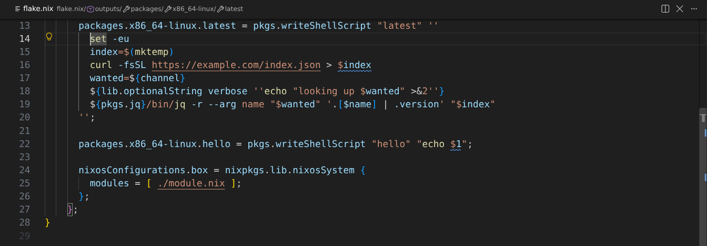
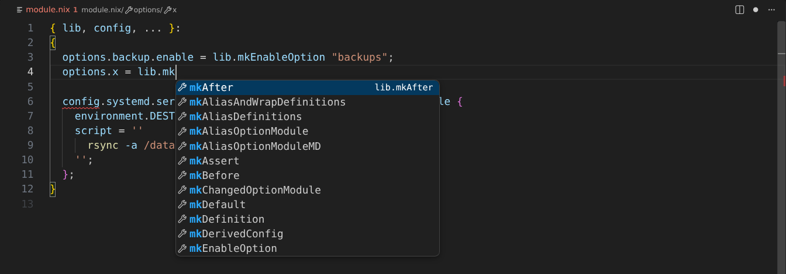

# Nix files

shell-lsp is a language server for Nix and for everything written inside Nix
strings. This page is the full reference; the
[README](../README.md#in-nix) has examples, and
[corpus.md](corpus.md#nix-server-parity) records how the answers compare with
nixd and nil. The Nix checks are listed in [rules.md](rules.md#sl8001).

- [Which strings are shell](#which-strings-are-shell)
- [Languages written from Nix](#languages-written-from-nix)
- [How a string becomes a script](#how-a-string-becomes-a-script)
- [Variables the Nix around a script sets](#variables-the-nix-around-a-script-sets)
- [The shell and the Nix answer for each other](#the-shell-and-the-nix-answer-for-each-other)
- [Strings passed to a wrapper in another file](#strings-passed-to-a-wrapper-in-another-file)
- [The Nix language](#the-nix-language)
- [Rename](#rename)
- [Everything else](#everything-else)
- [What cannot be checked](#what-cannot-be-checked)

## Which strings are shell

A document is a Nix file when it ends in `.nix`, whatever language
identifier the editor gives it, or else when its language identifier is
`nix`. A string literal there is shell, with no marker needed, when it stands
in one of these places. The table of them was read from the option declarations
of a pinned nixpkgs and home-manager, and an attribute counts wherever it is
written: as one long path, as nested sets, inside `flake.modules.x.y`,
`home-manager.users.x` or any other prefix, and through a function such as
`lib.mapAttrs`.

- **Derivations:** a phase or hook (`buildPhase`, `installPhase`, `preConfigure`,
  `postInstall` and the other `pre`/`post` hooks, `buildCommand`), a `shellHook`,
  the script of `runCommand`, `runCommandLocal`, `runCommandCC`,
  `runCommandNoCC`, `runCommandNoCCLocal` and `runCommandWith`.
- **Writers:** `writeShellScript`, `writeShellScriptBin`, `writeShellApplication`
  (`text`), `writeBash`, `writeBashBin` (also with their options), `writeDash` and
  `writeDashBin` (as `dash`), and `writeScript` and `writeScriptBin`, which run
  what their shebang names.
- **Images and environments:** `runAsRoot` and `extraCommands` of
  `dockerTools.buildImage`, `extraCommands` and `fakeRootCommands` of
  `buildLayeredImage` and `streamLayeredImage`, and `runScript`, `profile`,
  `extraBuildCommands`, `extraInstallCommands` and `extraPreBwrapCmds` of
  `buildFHSEnv`.
- **Units:** `script`, `preStart`, `postStart`, `preStop`, `postStop` and `reload`
  of `systemd.services.*` and `systemd.user.services.*`, also under
  `boot.initrd`. The `Exec*` strings of `serviceConfig` and home-manager's
  `Service`, also in a list, are command lines with their `-`, `+`, `@`, `:` and
  `!` prefixes dropped.
- **NixOS:** `system.activationScripts.*` and `system.userActivationScripts.*`,
  as a string or `.text`, `environment.shellInit`, `loginShellInit`,
  `interactiveShellInit`, `extraInit` and `shellAliases.*`, `programs.bash.*Init`,
  `logout` and `shellAliases.*`, `programs.zsh.*Init` and `shellAliases.*` (as
  zsh), `boot.initrd.pre*Commands` and `post*Commands` (as BusyBox),
  `boot.postBootCommands`, `extraInstallCommands` of the boot loaders,
  `networking.localCommands`, `firewall.extraCommands` and
  `extraStopCommands`, `nat.extraCommands` and `extraStopCommands`,
  `dhcpcd.runHook`, the hooks of `networking.wireguard.interfaces.*` and
  `networking.wg-quick.interfaces.*`, `powerManagement.*Commands` and
  `services.xserver.displayManager.sessionCommands` and `setupCommands`.
- **home-manager:** `home.activation.*`, `home.extraProfileCommands`,
  `home.extraBuilderCommands`, `home.sessionVariablesExtra`,
  `home.shellAliases.*`, `onChange` of the files below, `programs.bash.bashrcExtra`,
  `initExtra`, `profileExtra` and `logoutExtra`, `programs.zsh.initContent`,
  `initExtra`, `initExtraFirst`, `initExtraBeforeCompInit`, `completionInit`,
  `envExtra`, `profileExtra`, `loginExtra`, `logoutExtra`, `shellGlobalAliases.*`
  and `siteFunctions.*` (as zsh), and a value of `programs.git.settings.alias` or
  `programs.git.aliases` that starts with `!`.
- **Named files:** the text of `writeText`, `writeTextDir`, `builtins.toFile`,
  `writeTextFile`, `home.file.*`, `xdg.configFile.*`, `xdg.dataFile.*`,
  `xdg.stateFile.*` and `environment.etc.*`, when its shebang names a shell, or else
  when its file name does (`.sh`, `.bash`, `.zsh`, `.dash`, `.ksh`, a shell's rc
  file). The name is `destination`, then `target`, then the attribute or argument
  that names the file.
- **By hand:** a `/* bash */` (or `sh`, `dash`, `zsh`, `ksh`, `shell`) comment right
  before it.
- **Through a function in the same file:** static following shows it hands the
  string to one of the above: its formal is the `text` of `writeShellApplication`,
  the script argument of a writer or of `runCommand`, a phase of a derivation, a
  `${text}` on a line of its own in a shell string, or the argument after `-c`
  there, also through `lib.escapeShellArg`, through further functions and through
  an alias of a writer. Such a function may also write `writeTextFile` with a
  shell's shebang.

Strings known to be in another language are not read as shell: `writeFish`,
`writeNu`, `writePython3`, `writePyPy2`, `writePyPy3`, `writePerl`, `writeRuby`,
`writeLua`, `writeJS`, `writeRust`, `writeHaskell`, `writeNim`, `writeGuile`,
`writeBabashka`, `writeFSharp`, `writeRscript` and `writeCBin`, `testScript` of a
NixOS test (Python), `programs.fish.*`, `programs.nushell.*` and
`services.udev.extraRules`. A `${name}` of such a writer still hovers with the head
of what it writes, in that language. `security.wrappers` and `makeSetupHook` take
paths, so they hold no string to read, and only the writer behind them counts.

## Languages written from Nix

A string in a named file whose name is that of a justfile, Makefile or Dockerfile
gets everything those languages have in a file of their own, at its place in the
`.nix` file: the syntax errors and checks of the language (`SL5`, `SL6` and `SL7`)
including names that are never used, Hadolint's `DL` rules with its `# hadolint`
pragmas and `.hadolint.yaml`, the shell in its recipes and `RUN` lines with all its
linting, highlighting and navigation in the shell the file decides, semantic tokens,
completion, signature help, and definition, references and hover for its recipes,
targets and variables. `${...}` stands for text no one can know, and a finding that
touches one is dropped. Hover and rename answer as that language does: a rename edits
every read in the string and is refused when one would write into a `${...}`. Findings
offer the fixes they have in a file of their own, written back with the string's
escapes; edits that would together empty the shallowest lines of an indented string,
and so re-indent the rest, are withheld, and fixes that would do so only together
stay out of fix-all. The same goes for such a file written by a string named `x.nix`,
at any depth. An `include` or `import` in such a file resolves to another file written from
the same place in Nix (`home.file."x/justfile"` and `home.file."x/lib.just"`). What
it does not find is reported for a file in the store (`writeText` and the like), where
nothing can stand beside it, and not for a file placed in the home directory or `/etc`,
where a real file may.

A string in a named file whose name ends in `.nix` is Nix: its syntax errors and
checks, semantic tokens, and definition, references and hover for its bindings answer
inside the string, with the shell strings it holds read as anywhere else. It is not
followed across files, its names are not renamed, and a finding that touches a `${...}`
is dropped. Its refactorings are offered too, titled with the file they apply to, and
written back through the string.

## How a string becomes a script

The binding counts through `lib.optionalString`, `lib.mkIf`, `mkBefore`,
`mkAfter`, `mkForce`, `mkDefault`, `mkOverride`, `mkOrder`, `lib.hm.dag.entryAfter`,
`entryBefore`, `entryBetween`, `entryAnywhere`, `lib.stringAfter`, `noDepEntry`,
`fullDepEntry`, `if ... then ... else` and `or`, the items of `lib.mkMerge`,
`concatStringsSep`, `concatStrings` and `concatLines`, the bodies of `concatMapStrings`,
`concatMapStringsSep`, `map` and `mapAttrsToList`, and the strings joined with `+` in
one binding are one script, so an `if` may open in one and close in another.

An antiquotation in a shell string is read for what it is:

- A string it holds is shell in that place: `${lib.optionalString c "..."}`, `${if c
  then "..." else ""}`, the items of `concatStringsSep`, `concatStrings` and
  `concatLines`, and the bodies of `concatMapStrings`, `concatMapStringsSep`, `map`
  and `mapAttrsToList`. Of an `if` with text in both branches the first is read. Inside
  shell single quotes it stays one word.
- A shell writer in it (`${writeShellScript "x" ''...''}`) is read as a script of its
  own that the outer one runs, as `$(...)`.
- As a command word, `${pkg}/bin/foo` and `${lib.getExe' pkg "foo"}` are the program
  `foo`, and `${lib.getExe pkgs.foo}` is `foo` or the `mainProgram` of well-known
  packages (`gnused` is `sed`, `ripgrep` is `rg`), also behind `sudo`, `env` and the
  other wrappers. Every check, hover and embedded `jq`, `awk` or `sed` program treats
  it as that command. Its name is not edited, since the antiquotation decides it.
- `lib.escapeShellArg`, `toString` and the program getters lead to what they read.
- Anything else stands for text the shell cannot know, so nothing is reported about
  the placeholder itself. With `enable=unescaped-antiquotations`, `SL8014` reports
  one inside a command's argument whose value is not provably safe.
- Strings sourced into a session (shell init, aliases, `shellHook`, activation
  entries) and strings marked only by a `/* zsh */` comment keep what they define for
  later, and a sourced path is not followed. `$out` and the other builder variables
  whose values cannot hold a space, and the variables Home Manager gives an activation
  entry, count as safe to leave unquoted.

- Indentation is removed as Nix removes it, `'''`, `''$` and `''\x` (or `\"`,
  `\$` and the other escapes of a `"` string) are what Nix makes of them, and
  every other `${...}` stands for text the shell cannot know. Fixes are escaped for
  the string they land in, and new lines get its indentation.
- A phase runs as stdenv runs it: inside a function, with `set -eu -o
  pipefail`, in the same shell as the other phases, and with every attribute
  of the derivation and of its setup hooks in the environment, so reading a
  variable the phase never sets is not reported (`SC2154`). The same goes for
  a `shellHook` and for a script with a non-empty `environment`, `runtimeEnv`
  or wrapper `env`. The scripts of the writers and of systemd units otherwise
  run on their own, and `writeShellApplication` adds its strict mode and
  honours its `excludeShellChecks`.
- Each string is checked as the shell its place decides: phases, the bash writers,
  units and activation scripts are bash, `writeDash` is dash, zsh options are zsh, and
  a file or shebang says for itself. A string read into a shell someone else set up,
  such as an init option or alias, does not report variables it never sets or reads
  (`SC2154`, `SC2034`).

## Variables the Nix around a script sets

Inside the shell, a variable that the Nix around it puts in the environment
leads to the attribute that sets it, with definition, references, document
highlight and hover showing the binding and where it comes from. These are:

- in a phase or `shellHook`, the attributes of its derivation, also
  `inherit`ed ones (where definition goes on to what the `inherit` reads) and
  those under `env`, but not `meta`, `passthru` or `__`-prefixed ones, so
  `$pname` and `''${version}` reach `pname = ...;` and `version = ...;`. A set
  merged with `//` or an `env` that is a value from another file counts too;
- `$xPath` for a name `x` in `passAsFile`, which leads to `x`, and a name after
  `--set` in `makeWrapperArgs`, whose hover says that it reaches the wrapped
  program and not the phases;
- in a `runCommand` script, the attributes it is given;
- in a systemd unit's scripts, its `environment`, also spelled as one long path;
- in a `writeShellApplication`'s `text`, its `runtimeEnv`;
- in a wrapper's string, the keys of the argument that wrapper passes on as the
  environment, so `env.x` reaches `$x`;
- when nothing nearer sets it, `home.sessionVariables`,
  `environment.variables` and `environment.sessionVariables` of the project's
  modules, of any class.

In a phase, `$out`, `$src`, `$pname`, `$version`, `$name`, `$system`, `$builder`,
`$stdenv`, `$srcs`, `$outputs`, `$prefix`, `$sourceRoot`, `$phases`, `$curPhase`,
`$NIX_BUILD_TOP`, `$NIX_BUILD_CORES`, `$NIX_STORE`, `$NIX_LOG_FD`, `$TMPDIR`,
`$TMP`, `$TEMP`, `$TEMPDIR`, `$HOME`, `$PATH`, `$PWD`, `$SHELL`, `$CONFIG_SHELL`,
`$SOURCE_DATE_EPOCH` and `$TZ` are known to come from the builder or `setup.sh`:
hover says so unless an attribute sets them, and they are never reported.

An attribute that sets a variable is not renamed, from the shell or from itself,
since other Nix code may read it by its name.

## The shell and the Nix answer for each other

The shell and the Nix around it answer for each other:

- `${...}` in a shell string is Nix: every feature of the Nix language answers
  inside it.
- A `$name` in a jq or awk program follows its flag: `jq --arg name "$value" '$name'`
  and `awk -v name="$value" '...'` lead from the variable to the flag, on to the shell
  variable, an assignment `value=${x}` and the Nix binding or attribute behind it, also
  in another file. Definition lists each of them, references hold them all and hover
  shows the chain, in a plain shell script too. Renaming `$name` renames the flag and
  the reads in that program and leaves the rest, which keep their own names; it is
  refused when the program also reads `$ARGS` or when an antiquotation or escape splits
  the name.
- A command word `${pkg}/bin/foo`, `${lib.getExe pkg}` or `${pkg}` is that
  program. On the shell text next to the antiquotation, hover says what it runs,
  and definition goes to the binding of `pkg` when `pkg` is a name bound in the
  project. Definition on the name itself in `${pkgs.jq}` reads the locked nixpkgs.
- A name bound to `writeShellScript`, `writeShellApplication`, the other writers
  or a wrapper is a command where it is interpolated. Definition and references
  reach it, hover shows the first lines of the script, and call hierarchy
  crosses the link. Its caller is the script that holds the string.
- A name bound to `writeText`, `writeTextFile`, `builtins.toFile` or a writer of
  another language is a file whose content is known: hover on `${cfg}` shows the head of
  what it writes, also when that is an expression such as `builtins.toJSON { ... }`.
- A command in `text`, a phase or a unit that matches an item of `runtimeInputs`,
  `buildInputs`, `nativeBuildInputs`, `packages` or `path` leads to that item, or
  to the script the item names.
- The phases of one derivation share a shell, so an assignment, `export` or
  function reaches later phases in the order `setup.sh` runs them: `shellHook`,
  then `pre`, the phase and `post` of unpack, patch, configure, build, check,
  install, fixup, installCheck and dist. Definition, references and rename follow
  it. A read before the phase that sets it, or in another derivation, leads
  nowhere and hover says why.
- In a shell string, `nix build .#x` and the other uses of `nix` with a `.#` word
  lead to `x` of the flake that holds the file, looked up directly and under
  `packages`, `legacyPackages`, `apps`, `checks`, `devShells`,
  `nixosConfigurations` and `homeConfigurations`. This assumes that the command
  runs in that flake. `nix-shell -p x` leads to `x` where one of the project's
  overlays sets it; anything else in nixpkgs leads nowhere.
- A here-document inside a shell string is Nix when its delimiter is `NIX`, `nix`
  or `EOF_NIX`, when `# nix` follows it on its line, or when its line names a file
  ending in `.nix`. Its syntax errors are reported and its bindings navigate, but
  are not renamed. A body with `${...}` or an escape in it is left as text, since
  only evaluating it would show the Nix, and so is a Nix expression given to
  `nix eval --expr`.

## Strings passed to a wrapper in another file

A string passed to a wrapper defined in another file is proven by following the
project, and a keystroke never does that. Navigation, hover, references and call
hierarchy answer in it as soon as a request reads the project. Its shell is linted
and highlighted once a background pass has proven it: that pass follows the
project from each open Nix file that has such a call, one at a time, after 750 ms
without a change to an open Nix file or after a watched file or a setting changes,
then asks the client to refresh diagnostics and tokens if the proven strings moved.
Until then the string reads as plain Nix, and a diagnostics or tokens request on
its own builds nothing. Between passes a proven string follows edits around it and
inside it, and one whose opening was edited stops being shell until the next pass.
These strings report syntax errors and shell findings, explained on hover and fixed by
quick fixes and fix-all like any others. Workspace diagnostics and `shell-lsp check`
prove them for closed files too. `SC2154` stays off in a string the wrapper splices
into a larger script, or runs with an environment of its own (a derivation,
`runCommand`, a `runtimeEnv` or one the caller passes), since what it can read is not
known there, and reports reads never set in a string that is the whole script.

## The Nix language

Outside the shell, the Nix language answers too, within a file and across a project:

- Syntax errors and checks are reported, as they are in every Nix file.
- Definition, references, document highlight, hover and rename work for every
  binding: `let`, `rec` attributes, lambda arguments, formals, `@` aliases and
  `inherit`, also through `${...}` in a string. A cursor on `inherit x` means
  the `x` it reads.
- An attribute of a set is followed where the file itself proves it: through
  `s.a.b`, `s ? a`, `inherit (s) a` and `with s;` when `s` is bound in the file
  to an attribute set written there, and through the `@` alias of a function
  for its formals.
- Across files, the project is the nearest `flake.nix` with everything it
  reaches, plus the files that import the one at hand. Nothing is evaluated;
  what follows is read from the source:
  - `import ./x`, `import ./dir` (its `default.nix`), `callPackage ./x { }`,
    `pkgs.callPackage`, `lib.callPackageWith` and `imports = [ ./x ]`, also with
    the path in a `let` of the file. Definition on the path opens the file,
    `(import ./x).a` reaches `a`, and the keys of a call reach the formals of the
    file it calls.
  - In a flake, `inputs.x`, the `outputs` formal `x`, an `@` alias and the string
    of `follows` are all the declaration of the input `x`, and `self.y` reaches
    the output `y`. Where `flake.lock` locks the input and its source is in the
    Nix store, definition also opens its `flake.nix` or `default.nix`, and reads
    such as `inputs.x.lib.y` and `inputs'.x.packages.y` go on into the files
    there, up to 256 of them; nothing is downloaded, and nothing in the store is
    renamed.
  - `"${inputs.x}/y.nix"`, `"${./dir}/y.nix"` and `./dir + "/y.nix"` are paths,
    `~/x` is one below the home directory, and `import ./x` opens a file `x`
    without an extension before it tries `x/default.nix`.
  - `pkgs` and the `final` and `prev` of an overlay read what the project's
    overlays set: `final: prev:` functions under an attribute named `overlays`,
    such as `flake.overlays.x` and `nixpkgs.overlays`. So `pkgs.x.y` follows
    `lib.mapAttrs`, `lib.fix`, `makeExtensible` and `lib.extend`. Every overlay
    counts for every `pkgs` of the project, since which of them apply is only
    known by evaluating.
  - Modules are found from `mkFlake`, `nixosSystem`, `homeManagerConfiguration`,
    `darwinSystem`, `nixOnDroidConfiguration`, `evalModules`, `imports`,
    `nixosModules`-style outputs, `perSystem`, `withSystem`, `moduleWithSystem`,
    `home-manager.users.<name>`, `home-manager.sharedModules`,
    `flake.modules.<class>.<name>` and `import-tree`, which takes every `.nix`
    file below a directory unless its path below that directory has a segment
    starting with `_`. Modules of one class share one namespace: `options.a`,
    `config.a` and a plain `a` are the same name, so a read of `config.a` leads to
    every declaration and definition of it in every file. `_module.args.a`,
    `specialArgs` and `extraSpecialArgs` make `a` the same name as the formal `a`
    of the modules of that class, whose definition is the binding. The options of
    a `types.submodule` and `submoduleWith`, also under `attrsOf`, `lazyAttrsOf`,
    `listOf` and `nullOr`, and the names an option set gets from `mapAttrs`, are
    names below their option. A file in two classes joins them for the names it
    holds, so a rename reaches both.
  - A set built with `//` holds both sides, the right one first, when both are
    known.

  Nothing else is guessed. `pkgs.hello` that no overlay sets is read from the
  locked nixpkgs source ([below](#everything-else)), and leads nowhere when there
  is no `flake.lock` or its nixpkgs is not in the store. The namespaces of two
  flakes never meet.
- The outline holds attribute sets, `let` blocks and functions with their
  parameters, nested as they are written, with the shell's functions inside
  the binding that holds them; workspace symbols list every attribute and
  `let` binding.
- Folding covers attribute sets, lists, `let` blocks, strings, lambdas and runs
  of comments, and selection ranges grow from the shell in a string through the
  Nix around it.

## Rename

A rename refuses, with the reason and the place, to rename to anything but a plain
name, or when another binding would capture a read of the new name or be shadowed by
it. Where other files or the module system read the name, the message lists those reads
as `file:line`, so you can change them by hand and rename after.
It also refuses names the evaluator itself reads, such as `__overrides` and the
`body` of a legacy `let`, and an attribute of a non-recursive set unless every
read of that set is proven, since anything else could read it by its name. What
it does:

- `inherit x` stays an attribute named `x`: renaming the binding it reads writes
  `x = new;`, and renaming a binding made by `inherit x` writes `new = x;`, also
  taking it out of an `inherit` with several names.
- A formal is part of the function's interface. Renaming one also renames its
  reads through the `@` alias and the keys passed at calls of that function, in
  this file and in the files that reach it by `import` or `callPackage`. It is
  refused for a formal of a `callPackage` target that some caller leaves for
  `callPackage` to fill by name, and for a formal of a module or of `outputs`,
  which are passed by name, unless it is an input or a `_module.args` name the
  project binds itself.
- A `rec` attribute is renamed with its reads in the project.
- An attribute of the value of a file is renamed with its reads when every
  `import` of the file selects from it directly or through a `let` that is only
  selected from.
- An option is renamed everywhere in its class when the project declares it, or
  a set above it, in `options`, and no read passes a set above it on as a value or
  selects from one with a computed name. Options declared elsewhere, such as
  `services.nginx.enable` and `flake`, keep their names.
- An input is renamed with its declaration, formals, reads and `follows`, unless
  `inputs` is read with a computed name. `flake.lock` follows on the next
  `nix flake lock`.
- A project of more than 4096 files or 8 MiB of source is not followed past that,
  and a workspace scan stops at 20000 files. Following also stops at 32 levels of a set that
  holds itself, at 32768 attribute paths of modules, after 2^24 steps and after 8
  rounds that still find something new. In each of these cases a rename that has
  to know every reader is refused with the reason.

## Everything else

Diagnostics stay within the file, so typing never walks the project; it is read
when a request needs another file, and only files that changed are parsed again.

Beyond that, Nix files get these:

- The lints of statix and the findings of deadnix, as `SL8xxx` checks with fixes, a
  nearest `statix.toml` and `# deadnix: skip` comments honoured, and further checks
  for Nix pitfalls; see [the check list](rules.md#statix-and-deadnix-compatibility).
- Inlay hints name the parameter of a positional argument and the file a directory
  path opens, links open paths and web addresses, and call hierarchy follows
  functions across files.
- Completion, hover and signature help cover the builtins, keywords, bindings,
  attributes and paths the file can see.
- A "▶" lens on a flake output runs `nix build`, `nix run` or `nix flake check`. A
  dev shell needs a terminal: a client with the experimental capability
  `shellLsp.runsInTerminal`, such as the VS Code extension, gets a "▶ nix develop"
  lens whose client-side command `shellLsp.runInTerminal` receives `{name, argv, cwd}`;
  any other client gets "▶ Build dev shell", which proves the shell builds with
  `nix develop --command true`.
- Without evaluating anything, `lib.x` is read from the source of the locked
  nixpkgs: hover shows its documentation, definition goes to it and completion
  lists the library. Names read through `with` go to that `with`, and references
  list that name through it. `config.x.` and option keys complete from every file
  of the project, and `inputs.` from the flake.

  

- Without an evaluator, definition and hover read `pkgs.x` from the locked nixpkgs
  source, or from the checkout when the file is inside nixpkgs, and `lib.x` the same
  way, looking through `lib.mapAttrs` and into what `makeExtensible` adds, as
  `lib.extend`. Completion in `with lib.licenses;` offers its names.
- `finalAttrs` in `mkDerivation (finalAttrs: { ... })` is the set it returns, for
  definition, hover, references and completion. So is the argument of `fix` and
  `makeExtensible`.
- Completion in the argument of `mkDerivation`, `mkShell`, `writeShellApplication`
  and `writeTextFile`, and in a derivation's `meta`, offers the keys they take.
- In a phase, the commands `stdenv` and its setup hooks bring in, such as
  `wrapProgram`, `makeWrapper`, `substituteInPlace` and `patchShebangs`, answer hover,
  completion, signature help and their flags, and definition goes to the input that
  brings them in. A function of the same name in the script wins.
- Separate scripts do not share variables: definition, references, rename, hover and
  completion stay in the script the cursor is in, and `phases` of one derivation meet
  in the order they run.
- Shell checks read each script alone as well, so one script does not hide `SC2034` or
  `SC2154` in another. The phases of one derivation and the pieces of one module option
  count as one script, and what a sourced surface or an `overrideAttrs` phase assigns or
  reads stays visible to every script in the file.
- Type definition on an option goes to the `type` its `mkOption` gives.
- With `nix.evaluate`, definition follows `pkgs.x` to `meta.position`, or to where the
  attribute is bound when there is none or it is not a package (`pkgs.runCommand`),
  `lib.x` to that same position when the source of the library cannot follow it, and
  an option to its declaration, fetching the file first when it is not on disk, and option
  completion finds the class of a module passed through a `deferredModule` option.
  Nix evaluation requires Nix 2.24 or newer, Lix 2.95 or newer, or Determinate Nix
  based on Nix 2.24 or newer.
- Hover on a flake input shows its locked revision and date, and the code action
  "Update input x" runs `nix flake update x`.
- The refactorings are extract to a `let` binding, inline a `let` binding, spell
  `x = x;` as `inherit x;` and an `inherit` as bindings, rewrite a string between its
  quoted and indented forms when its value stays the same, quote or unquote an
  attribute, nest or flatten an attribute path, convert a `with` whose names only it
  can answer to `let inherit`, and extract a binding to a new file beside this one
  when its value reads nothing through a `with` and its name can spell a path. The
  file is offered only if it does not exist and the client can create files, and takes
  the names the value reads from this file as arguments.
- `finalAttrs` reads the set its function returns in any builder, and `x.` offers what
  this file reads through the same `x` when nothing else knows what `x` holds.
- A flake input completes its keys, such as `follows` and `url`.
- `pkgs.x` follows an alias in `pkgs/top-level/aliases.nix` to the package it names.
- An undefined name offers "Change to" the closest name in scope, and "Add to the
  arguments of this function" for the nearest function with a pattern.
- `url = "github:o/r"` in a flake links to the page of that repository, also for
  `gitlab:` and `sourcehut:`.
- Typing `;` formats the binding it ends, in editors that have format on type on.
- Each finding offers "Ignore here" and "Ignore in this file" fixes, a malformed
  `disable` list reports `SC1125`, and with `enable=unused-directives` a directive
  that suppresses nothing reports `SL2009`.

## What cannot be checked

Shell that Nix assembles across `${...}`, such as a `case` whose patterns come
from `lib.optionalString`, cannot be checked, since only evaluating the Nix
code would show it, and may be reported as a syntax error.
